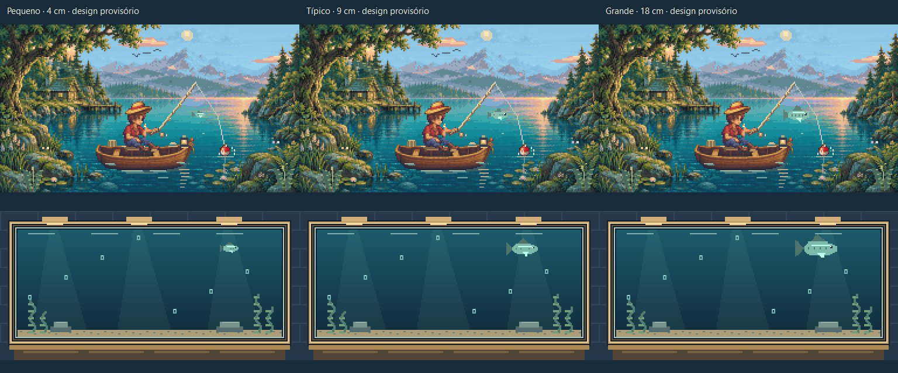
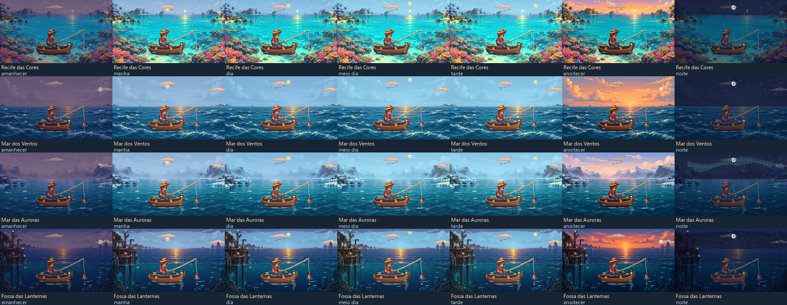
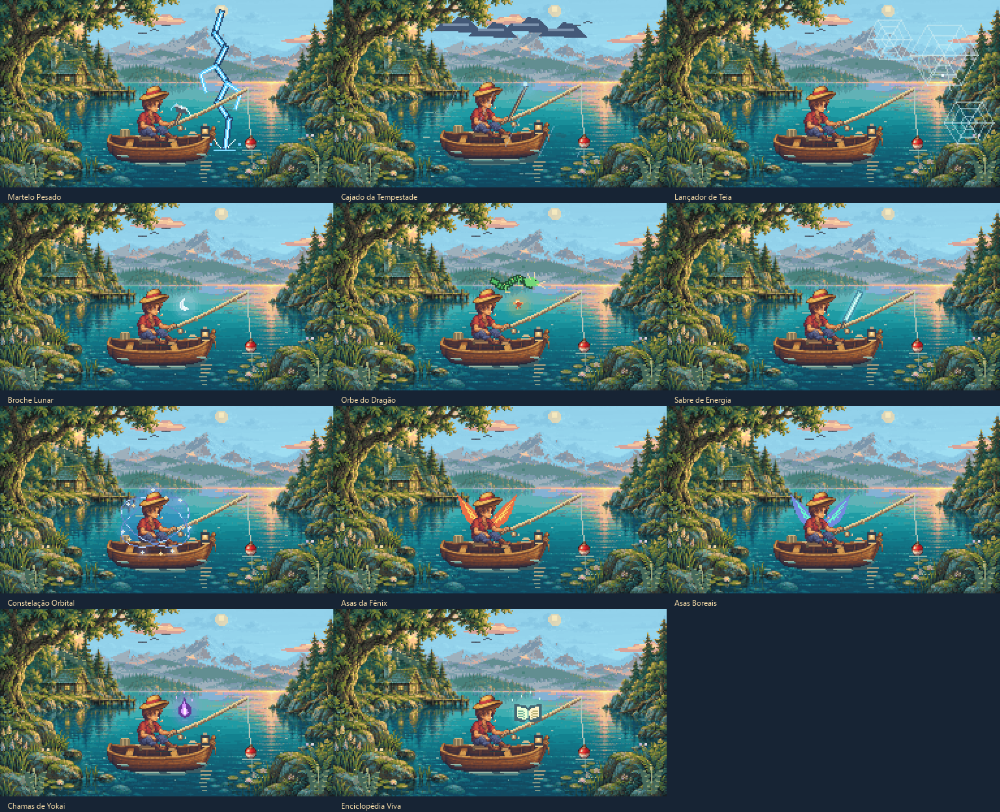

# Pesca Idle — piloto de tamanhos e recordes

Esta branch `codex/piloto-tamanhos` publica o candidato local para revisão, sobre a base com museu `2a0353ff7c1cae2dca69d08c222b0660770d4385`. Não houve merge na main nem integração com Fluxo/Precisão.

## Aquário com movimento - passos 1 a 5 completos

Os 68 moradores do tanque têm arte própria e movimento discreto de cauda/nadadeiras. [Baixar a demonstração visual Windows](https://github.com/BernardoJ/PescaIdle/raw/refs/heads/codex/piloto-tamanhos/PescaIdle-Aquario-Demo.exe), salvar em uma pasta gravável e abrir com dois cliques. É um visualizador em memória, sem progressão nem save; permite pausar, avançar quadros, trocar espécies e comparar exemplares do piloto.

[PDF completo com os cinco passos](output/pdf/PescaIdle_Aquario_Completo.pdf) · [GIF do movimento](docs/aquario-especies/movimento/evidencias/movimento-ampliado.gif) · [Reprodução e limites](docs/aquario-especies/movimento/README.md) · [Testes, desempenho e pacote](docs/aquario-especies/movimento/RELATORIO.md).

A animação foi integrada ao código-fonte do tanque. Os executáveis antigos do jogo completo abaixo permanecem históricos; a nova demonstração visual é separada.

## Arte dos peixes no aquário - 23/10/2026

Os **68 peixes elegíveis** agora têm desenhos próprios no tanque, com formas e marcas por espécie e detalhe adaptado ao tamanho de exibição. A mudança preserva a escala do piloto e afeta somente a arte dentro do aquário. [Escopo, referências e reprodução](docs/aquario-especies/README.md) · [Relatório com screenshots em PDF](output/pdf/PescaIdle_Aquario_Especies.pdf) · [Antes/depois e limitações](docs/aquario-especies/relatorio.md).

Esta atualização está no código-fonte; os executáveis e APKs históricos abaixo não foram recompilados nesta entrega visual.

## Demonstração revisada — 19/10/2026

Correção de IDs pendentes, recordes mais claros e um roteiro sintético isolado: execute `python -B piloto_entry.py --demo` com o ambiente existente. [Como experimentar, perfil separado, testes e build local](docs/piloto-tamanhos/demo/README.md). A build **Tamanhos-Demo** é separada e fica local; o download histórico abaixo não inclui essas correções.

## Abrir com dois cliques

**[Baixar PescaIdle-Tamanhos-Piloto.exe](https://github.com/BernardoJ/PescaIdle/raw/refs/heads/codex/piloto-tamanhos/PescaIdle-Tamanhos-Piloto.exe)**

Salve o EXE em uma pasta gravável e abra. Ele inclui runtime e recursos; não exige instalar Python. O perfil novo fica em `perfil-piloto/save.json`, junto ao EXE. O piloto recusa perfis fora dessa pasta-base e não abre o save pessoal em APPDATA.

Build Windows de 18/10/2026: **50.200.863 bytes**, SHA-256 `4229707d91ed82b519178e18ea6143cc8a86b3e164f02aaf5826abce32eaff27`.

## Conteúdo

- Comprimentos individuais para Lambari, Tilápia-do-nilo, Carpa-comum e Traíra; valores provisórios de design.
- Menor/maior exemplar por espécie na enciclopédia e cinco conquistas sem bônus econômico.
- Variação visual na captura e no aquário; seleção menor/maior nos três espaços.
- Save schema 4 exclusivo do piloto, com marcador `tamanhos-v1`, backup de migração e perfil isolado.
- As outras espécies, economia, tempos e varas existentes permanecem com as regras da base.

[Entrega, comandos e limitações](docs/piloto-tamanhos/README.md) · [Parâmetros](docs/piloto-tamanhos/PARAMETROS.md) · [Relatório local sanitizado](docs/piloto-tamanhos/RELATORIO.md)



Evidências da preparação local de 18/10/2026: 12 testes passaram, 16.010 eventos em 48 fluxos pareados iguais à base quanto a espécies/moedas/tempos, smoke do EXE em três processos e prévias Qt desktop/mobile. Não foram repetidos jogo/simulações para esta publicação. **Android nativo deste piloto não foi testado.**

O arquivo antigo `PescaIdle.exe` e os APKs preexistentes foram preservados e não contêm este piloto. Use o EXE com **Tamanhos-Piloto** no nome. Para retornar, feche o piloto e abra o jogo anterior; não transfira o save do piloto para a versão principal.

<details>
<summary>Documentação histórica da base, anterior ao piloto (comandos, saves e binários não descrevem esta branch experimental)</summary>

# Pesca Idle — Oito Águas

Jogo idle de pesca em Python/PySide6, com arte original em pixels e adaptação Android.

## Entrega local: museu inicial

Esta branch acrescenta **Museu** ao menu, com um aquário para até três espécies diferentes já descobertas. Selecionar, trocar e retirar não consome capturas nem moedas. Encontros especiais ficam fora deste aquário. A exposição é salva; não há alimentação, renda ou punição por ausência.

Esta entrega está somente no código local. Os EXEs e APKs existentes são anteriores ao museu e não foram substituídos. [Diagnóstico, medições, imagens e limites](docs/MUSEU_PRIMEIRA_ENTREGA.md).

Para experimentar com descobertas de exemplo e um perfil temporário, no ambiente Python/PySide6 já configurado:

```powershell
python tools/preview_museum.py
python tools/preview_museum.py --empty
```

Essa prévia não abre o save pessoal e descarta o perfil de teste ao fechar. O jogo normal abre pelo código em `pesca_idle.py`; faça sessões de QA somente com `PESCA_IDLE_SAVE_PATH` explícito. Não foram implementadas as etapas posteriores de clima, equipamentos ou distribuição do catálogo.

## Jogar com dois cliques

Baixe o [PescaIdle.exe atualizado](https://github.com/BernardoJ/PescaIdle/raw/refs/heads/codex/android-auditoria/PescaIdle.exe), salve no computador e abra com dois cliques. Não precisa instalar Python. O executável na raiz desta branch contém todos os recursos.

Build Windows: **50.164.461 bytes**. SHA256: `be4143ddea790ef76fe2045d149d0456969bd44e4f468e5eb9d43fdc06ecd4a9`.
[Correções e validação atual](docs/AUDITORIA_ANDROID.md) · [Android](ANDROID.md).

## Jogar no Android

Baixe o [PescaIdle-Android.apk — beta ARM64](https://github.com/BernardoJ/PescaIdle/releases/download/v2.1.0-android-beta.1/PescaIdle-Android.apk) e abra para instalar. O Android pode pedir permissão para instalar por esse navegador/gerenciador. O pacote inclui o jogo, o runtime e os recursos; não requer outro aplicativo.

Alvo desta beta: **Android 9+, ARM64, páginas de memória de 4 KB**. Compatibilidade com páginas de 16 KB e teste em telefone físico permanecem pendentes. Instalação, funcionamento e rotação foram testados em emulador Android 15 x86_64 com o mesmo código/arte. [Relatório e limitações](docs/AUDITORIA_ANDROID.md).

APK: **151.170.080 bytes**. SHA256: `beeaeb7354b4215572e15151b1270384fee124645d68dc63c687b8e1b4adc279`.

## O que mudou

- Oito mapas, com sete cenários inéditos, desbloqueados permanentemente por nível de barco. Viagem gratuita pelo menu **Viajar**.
- 88 espécies aquáticas: 49 antigas preservadas e 39 novas; 68 peixes e 20 encontros especiais. Baleias e semelhantes são avistamentos, e plâncton é registrado por amostra.
- Sete períodos pelo relógio local: Amanhecer 05–07, Manhã 07–09, Dia 09–11, Meio-dia 11–14, Tarde 14–17, Anoitecer 17–20, Noite 20–05. Fim exclusivo.
- **Enciclopédia** com ordem alfabética/quantidade e filtros por local, período e disponível agora. Valor em 1 registro, raridade em 5, curiosidade em 10. Mostra descobertas por padrão; pistas opcionais de desconhecidas não revelam a identidade.
- Coleção global e regional separadas. Conquista original **Rei da pesca** conserva a meta de 49; **Explorador das oito águas** usa as 88 da expansão.
- **Fashionista**: somente cosméticos vendidos, excluindo o livro Enciclopédia Viva, opções grátis e peças de upgrade. A tela mostra progresso e nomes que faltam; recalcula ao abrir e comprar. **Enciclopédia Viva**: todas as informações reveladas, com acessório de livro flutuante grátis como recompensa.
- Capuz de raposa/elmo corrigidos, cabo de martelo menor, nuvens e chuva no cajado, mais teias, broche lunar luminoso, dragão verde orbitando a esfera laranja, brilho no sabre/constelação/chamas e asas mais vivas.
- Rótulos **Dragão Digital**, **Gorro de Rato Elétrico**, **Eu escolho você!** e **Mostre-me seu Coração Valente**, com IDs anteriores preservados.

A janela compacta abre no canto inferior direito, fica no topo e pode ser arrastada. A cena conserva 256×144 pixels lógicos, com ampliação inteira em pixels físicos e tipografia legível. Todos os cosméticos, os 11 níveis de barco/vara e a prévia da loja permanecem. Itens são ordenados por preço em cada categoria. Peças de upgrade são compradas na loja.




## Progresso e ausência

O save normal Windows continua em `%APPDATA%\PescaIdle\save.json`. A atualização migra para schema 3, com moedas em centésimos inteiros, backup anterior e escrita atômica. Preserva inventário, compras, equipamentos e conquistas. Normaliza o saldo antigo a duas casas, guardando o número original no backup. Capturas antigas continuam globais, sem atribuir local/horário desconhecido. Saves corrompidos ou futuros não são substituídos silenciosamente; um backup válido pode ser recuperado com confirmação. Duas instâncias não podem gravar no mesmo perfil. Android usa seu diretório privado.

Fisgadas congelam o resultado no início, inclusive ao viajar, pausar ou reabrir. O offline normal conta o **primeiro trecho de até quatro horas** da ausência, pescando em cada horário histórico; excesso é descartado uma vez. A pausa intencional persiste sem renda offline até retomar.

**Expedição offline** permite agendar um mapa liberado, nas próximas 24 h, por até 4 h. Substitui a renda normal daquela ausência. Paga somente a parte decorrida enquanto o jogo esteve fechado/suspenso; retornar consome a janela parcial. Não acorda o computador, não executa serviços e não paga tempo futuro. Se o jogo estiver aberto no início, o plano expira.

O replay usa UTC e offset salvo. Mudanças históricas de horário de verão durante a ausência não são reconstruídas. O jogo funciona offline, sem localização ou rede.

## Executar pelo código

```powershell
py -m venv .venv
.\.venv\Scripts\python.exe -m pip install -r requirements.txt
.\.venv\Scripts\python.exe pesca_idle.py
```

Ambiente efetivamente validado: Python 3.14.8, PySide6 6.11.2, Windows 11. Dependências estão fixadas nos arquivos de requirements. Para uma sessão manual de QA, configure o perfil **antes** de iniciar:

```powershell
$qa = Join-Path $env:TEMP ('pesca-manual-' + [guid]::NewGuid())
$env:PESCA_IDLE_SAVE_PATH = Join-Path $qa 'save.json'
.\.venv\Scripts\python.exe pesca_idle.py
```

## Build e validação

```powershell
.\.venv\Scripts\python.exe -m pip install -r requirements-build.txt
.\.venv\Scripts\python.exe -m PyInstaller --noconfirm PescaIdle.spec
```

Gera `dist/PescaIdle.exe`. O spec inclui PNG/JSON de produção recursivamente, preservando caminhos relativos; exclui masters de `assets/source`. Não inclui fontes, saves, ZIP, .git ou QA. Módulos e recursos são resolvidos pelo módulo/`sys._MEIPASS`, sem depender do cwd.

```powershell
$env:PESCA_IDLE_QA_DIR = Join-Path $env:TEMP ('pesca-qa-' + [guid]::NewGuid())
.\.venv\Scripts\python.exe tools\validate_game.py
.\.venv\Scripts\python.exe tools\smoke_exe.py dist\PescaIdle.exe
```

Os testes criam saves sintéticos e isolam APPDATA/LOCALAPPDATA antes de importar o jogo. O smoke usa plugin Windows, cwd estrangeiro e migra uma fixture v1. `validate_game` executa auditoria, matriz da expansão, regressão cosmética e balanceamento. `tools/test_windows_close.py <exe> --output <qa>` verifica saída nativa do processo e liberação do lock. `tools/validate_mobile.py` é uma prévia desktop, distinta do teste real do APK. Relatórios e imagens usam a pasta de QA, sem sobrescrever referências.

Resultados observados: **5.920** verificações da matriz e **1.359** de cosméticos; 56 cenas inspecionadas; 168 pools matemáticos e 7 inícios ×30 sementes de progressão. [Detalhes e limites](docs/VALIDACAO_EXPANSAO.md). O conjunto global antigo foi preservado como fixture de comparação, com seus 337 checks executados antes da expansão.

## Arquitetura e referências

- `pesca_catalogo.py` / `assets/catalogo_expansao.json`: única fonte de conteúdo no runtime, IDs e ocorrências regionais.
- `pesca_tempo.py`, `pesca_pescaria.py`, `pesca_offline.py`: relógio central, resultado pendente, RNG e replay histórico.
- `pesca_save.py`, `pesca_conquistas.py`: migração, persistência exclusiva/atômica, metas e recompensa.
- `pesca_idle.py`, `pesca_viagens_ui.py`, `pesca_ui.py`: janela, loja, coleção, viagem, expedição e diálogos.
- `pesca_visual.py`, `pesca_luz.py`, `pesca_regional_visual.py`, `pesca_efeitos.py`, `pesca_especies_visual.py`: composição, máscaras, iluminação, cosméticos e espécies.
- `assets/source/mapas`: masters inéditos do imagegen e prompts. `tools/prepare_maps.py --records <prompts.json>` prepara PNGs/máscaras finais; Pillow é só dependência de desenvolvimento.

[Expansão e arte](docs/EXPANSAO_MAPAS.md) · [Save e offline](docs/MIGRACAO_SAVE.md) · [Balanceamento](docs/BALANCEAMENTO_EXPANSAO.md) · [Fontes das 39 novas identidades](docs/FONTES_ESPECIES.md) · [Critérios antigos](CRITERIOS_RARIDADE.md).

A arte é própria, com personagem e barco existentes preservados e linguagem de RPG em pixels. Horários/ambientes são convenções do jogo; não representam coocorrência ou abundância científica exata. Curiosidades novas usam fatos taxonômicos verificados; as antigas foram preservadas e identificadas como legado.

</details>
