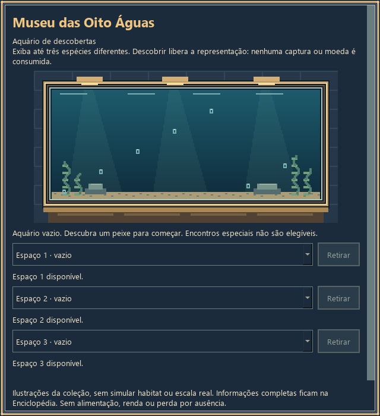
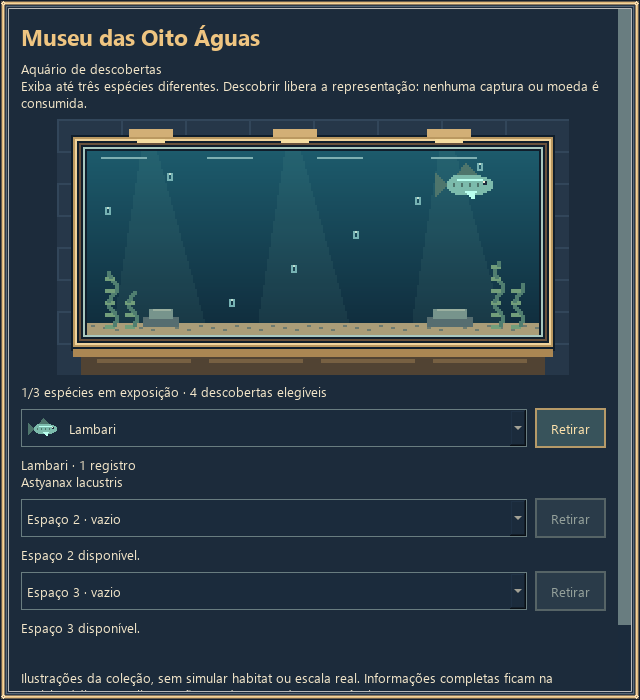
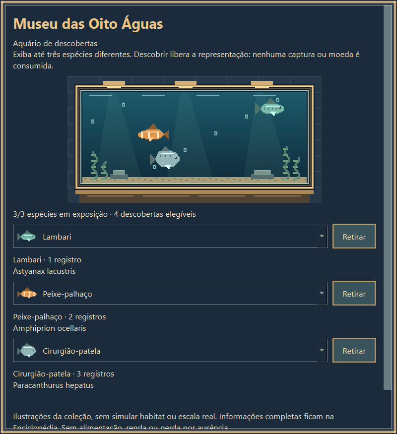
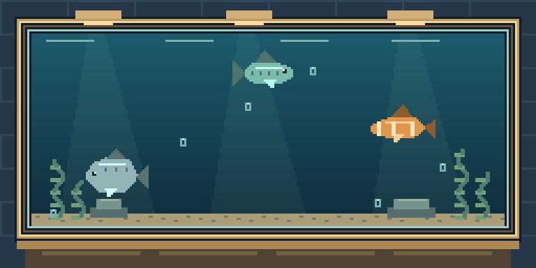
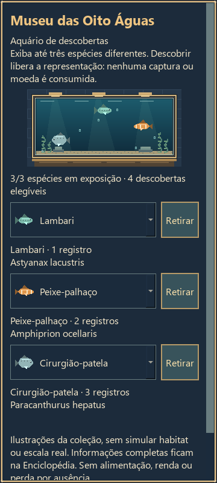

# Primeira entrega — Museu de descobertas

Data: 15/10/2026. Entrega **local**, sem publicação, merge, release ou substituição
de binários. Base confirmada explicitamente pelo usuário: PR #3, commit
`f5946680df4599c2c132cee7ca14256dd695b88a`.
Branch: `codex/museu-aquario-inicial`. Alterações locais ainda sem commit;
o manifesto e o patch da entrega identificam o snapshot revisável.

## Diagnóstico da base

As consultas desta tarefa confirmaram main em `6b29b4a`, PR #2 aberta em
`b4c8112` e PR #3 aberta em `f594668`, sobre a PR #2. A expansão é ancestral
da base escolhida. O checkout Desktop continua em `9103404`; os seis checkouts
existentes estavam limpos e foram preservados. Nenhum `AGENTS.md` ou skill local
aplicável foi encontrado nos caminhos inspecionados. O prompt fornecido foi lido
integralmente, assim como README e documentação de save/balanceamento da base.

| Área | Implementação existente preservada |
|---|---|
| Catálogo | `pesca_catalogo.py` e JSON: 8 mapas, 88 entradas; 68 `peixe`, 20 `especial` |
| Sorteio | `FishingEngine`: contexto e resultado congelados no início da fisgada |
| Equipamentos/progressão | Níveis 0–10; peça custa 30+20×nível, melhoria requer 2+nível peças |
| Coleção/conquistas | IDs globais, histórico regional e metas originais/expansão |
| Desenho | Qt/PySide6; pixels lógicos e sprites de `species_image` reaproveitados |
| Save | Schema 3, centésimos inteiros, backup, escrita atômica, lock e recuperação explícita |
| Ausência | Primeiras 4 h; relógio histórico, pausa intencional e expedição substitutiva |

Antes de editar a produção, `validate_game.py` passou na base: 11 testes de
auditoria, 5.920 checks da expansão, 1.359 de cosméticos e balanceamento
168 pools + 7 inícios ×30 sementes. São execuções **desta tarefa**, não números
copiados dos testes históricos das PRs.

## Museu entregue

- Menu **Museu** no Windows e no menu de toque.
- Um aquário com três espaços, de zero a três espécies distintas.
- Lista alfabética dos peixes descobertos. Espécies ocupando outro espaço ficam
  desabilitadas; o modelo também rejeita duplicação, IDs desconhecidos e espécies
  não descobertas/inelegíveis, mesmo quando chamado diretamente.
- Selecionar troca a exposição imediatamente; **Retirar** libera o espaço.
- Nome, nome científico e contagem histórica do catálogo existente. Não revela
  antecipadamente curiosidades/raridade bloqueadas na Enciclopédia.
- Peixes nadando, bolhas e reflexos com arte em pixels. No máximo três sprites,
  um timer de 66 ms; esconde/fecha/suspende e para, sem avançar pesca ou RNG.
- Editor rolável, estados vazios explicados, botões de toque e desenho em escala
  física inteira, inclusive em DPI fracionário.

Elegibilidade é explicitamente a categoria **`peixe`** do catálogo existente,
com pelo menos um registro em `inventario_por_id`. Não se adota uma nova
classificação biológica. Baleias, golfinhos, amostras e demais encontros
`especial` não entram no aquário. As imagens são representações de coleção,
sem afirmar habitat, escala ou compatibilidade real entre espécies.

Não há exemplares físicos: exibir **não consome** capturas, dinheiro ou cosméticos.
Não há alimentação, morte, limpeza, renda, preço de expansão ou punição por
ausência. O museu não sorteia capturas nem concede conquistas/recompensas.

## Save e migração

O schema global permanece **3**, com uma extensão opcional compatível:

```json
"museu": {"version": 1, "aquario": [null, null, null]}
```

Os três elementos guardam apenas IDs ou `null`; descoberta e contagem continuam
no inventário histórico. Perfis novos e saves v1/v2/v3 sem o campo começam com
exposição vazia. A inicialização é idempotente e não herda exposições de outro
perfil usado como defaults. Nenhuma região, clima ou isca foi atribuída ao passado.

Referências desconhecidas, especiais ou sem descoberta eventualmente presentes
num save são **preservadas**, não desenhadas, e sinalizadas como indisponíveis.
O jogador pode trocar/retirar explicitamente. Campos extras do museu e do perfil
continuam preservados. Estruturas malformadas, versões futuras do museu,
duplicações ou capacidade inválida impedem gravação/load com erro visível;
o arquivo original permanece recuperável, sem reinicialização silenciosa.

SaveStore, lock, serialização, fsync/replace, backup e recuperação não foram
reescritos. A mudança usa a transação existente. Falha ao salvar a exposição
mantém o snapshot anterior, informa o erro no painel e pausa a pesca. A
recuperação só restaura o backup após consentimento, arquivando bytes rejeitados.
O backup continua sendo o snapshot anterior; não é um histórico ilimitado.

Todos os testes usaram perfis sintéticos temporários e overrides estabelecidos
antes das importações. O save pessoal `%APPDATA%/PescaIdle/save.json` não foi
lido, aberto, migrado, copiado ou alterado.

## Medições iniciais, sem rebalanceamento

Ferramenta nova mínima: `tools/measure_museum_baseline.py`. Executada contra
o código **original f594668**, com hashes dos arquivos registrados no JSON.
30 sementes (0–29), relógio sintético em 15/10/2026, offset fixo zero, horizonte
de 4 h por corrida. Total: **210 progressões**, **90 perfis fixos**,
**90 comparações de retorno**. Não houve escrita de saves nesse simulador.

Progressão: permanecer na Enseada; comprar peças imediatamente, alternando
níveis completos de vara e barco; sem cosméticos, viagem ou decisões humanas.
A primeira melhoria é vara 1; barco 1 vem depois. Isso difere da política antiga
que priorizava duas peças de barco, portanto seus tempos não são intercambiáveis.

| Início | Vara 1, mediana min | Barco 1, mediana min | Três peixes, mediana s | Tentativas p90 / máximo |
|---|---:|---:|---:|---:|
| Amanhecer | 3,43 | 6,58 | 64,1 | 9 / 11 |
| Manhã | 5,28 | 10,17 | 57,7 | 6 / 10 |
| Dia | 5,28 | 10,17 | 57,7 | 6 / 10 |
| Meio-dia | 3,89 | 6,83 | 53,4 | 5 / 10 |
| Tarde | 3,89 | 6,83 | 53,4 | 5 / 10 |
| Anoitecer | 3,43 | 6,58 | 64,1 | 9 / 11 |
| Noite | 2,44 | 4,44 | 57,7 | 6 / 10 |

Todas as 210 corridas descobriram três peixes. O pior tempo observado foi
182,1 s; p90 varia de 84,5 a 147,6 s. A primeira peça teve medianas de
100,8–156,7 s e máximo observado de 290,4 s. Os registros brutos incluem
semente, checkpoints em 10/30/60/240 min, saldo, renda, capturas, diversidade,
primeira peça, todos os níveis e cada desbloqueio de mapa.

Outros desbloqueios: barco 3/Píer tem medianas 22,2–51,2 min nesta política.
Para barco 10, por exemplo, 0/30 inícios da manhã e 30/30 da noite alcançaram
o marco em 4 h; à noite a mediana foi 132,8 min. Casos não alcançados são
**censurados**, não tratados como sucesso ou usados como zero. Nenhuma corrida
completou todo o catálogo regional da Enseada nessa janela (0/210); isso não
estima o tempo da coleção global nem prova impossibilidade de completar.

Perfis fixos: sem compras/viagens, a partir de 09:00, durante quatro horas:

| Vara/barco e mapa | Moedas p10 / mediana / p90 | Capturas, mediana | Espécies, mediana |
|---|---:|---:|---:|
| 0, Enseada | 3.306,30 / 3.488,25 / 3.705,70 | 837,5 | 6 |
| 3, Píer | 4.382,08 / 4.599,16 / 4.857,76 | 1.170 | 8 |
| 10, Fossa | 100.985,40 / 106.494,90 / 111.054,90 | 1.844,5 | 4 |

São perfis sintéticos em mapas já liberados pelo nível indicado; não simulações
de uma pessoa chegando a esses níveis. Diversidade abrange também especiais.

Retornos: com vara/barco 3 fixos no Píer, ausências de 1 h e 4 h equivaleram ao
tempo contínuo nas 30 sementes. Em 8 h, um retorno pagou só 4 h: média 4.612,61
moedas, versus 9.781,39 contínuas; retornos horários renderam o mesmo que
contínuo em 30/30 casos, sem compras. A vantagem é do limite já existente, não
uma renda paralela. Dinheiro, inventário, RNG e resultado/período/equipamento
foram comparados exatamente. Somente resíduo temporal e timestamp derivado
têm tolerâncias explícitas (1 µs e 100 µs), devido à soma binária fracionada.

### Metas propostas para revisão — não implementadas

- Manter a primeira personalização acessível: três descobertas em cerca de
  1–3 min para a maior parte dos inícios, acompanhando p90 e piores sementes.
- Revisar primeiras escolhas de equipamento na faixa de 3–12 min, avaliando
  funções distintas em vez de simplesmente encarecer peças.
- Usar marcos intermediários de exploração/coleção na faixa de 20–90 min como
  hipótese de estudo; confrontar horários e estratégias antes de escolher metas.
- Investigar separadamente coleções raras: o ensaio de 4 h não sustenta uma
  promessa de conclusão. Propor objetivos parciais legíveis, sem exigir retorno
  frequente ou azar extremo como fonte principal de longevidade.

## Validação e evidências

Ambiente: Windows 11, Python 3.14.8, PySide6/Qt 6.11.2. Nenhuma dependência nova.

| Verificação desta entrega | Resultado |
|---|---|
| Base antes das alterações | 11 auditoria; 5.920 expansão; 1.359 cosméticos; 168 pools + 210 inícios aprovados |
| `validate_game.py` após integração | Auditoria, museu, expansão, cosméticos e balanceamento aprovados |
| `validate_museum.py` | 11 testes aprovados; migração v1/v2/v3, erro/backup, ações, reopen, RNG/economia, expedição/pausa |
| Aberturas pelo jogo | 50 ciclos, zero diálogos/timers retidos após DeferredDelete |
| Windows nativo | Controles/persistência, imagens e eventos Qt de toque/menu em escala 100% e 125% aprovados |
| Prévia mobile | 15 checks de viewport/painéis e retomada; 360×800, 800×360; museu também em 320×568 e 512×288 |
| Novo save/sem descoberta/1/3 espécies/sem elegíveis | Aprovados; seleção inválida rejeitada, referências preservadas |
| Prévia interativa descartável | Inicialização/encerramento aprovados, com e sem descobertas de exemplo |
| APK/emulador Android desta versão | **Não executado**: sem SDK/ADB/emulador e sem WSL local |
| Dispositivo físico Android | **Não executado**; eventos Qt sintéticos não certificam toque físico, ABI ou bateria |
| Novos EXE/APK de distribuição | Não gerados; binários anteriores intocados |

O primeiro ensaio visual encontrou fundo claro no conteúdo rolável Windows;
foi corrigido para o painel escuro e capturado novamente. Um primeiro ensaio
também corrigiu o seletor que permanecia ativo sem elegíveis. Nenhum teste de
integridade foi removido. A primeira medição de retornos usava igualdade binária
para tempos fracionados; a investigação mostrou diferenças de microssegundos,
com economia/RNG idênticos, e o comparador foi tornado explícito conforme acima.

Desempenho: na matriz existente, renderização da cena mediana/p95 passou de
1,52/1,79 ms na base para aproximadamente 1,45/1,59 ms nesta execução; troca
de mapas de 313,5 para 309,3 ms na mediana. Caches continuam limitados. Aquário
com três espécies: aproximadamente 0,11 ms por quadro, com p95 em torno de
0,11 ms (200 quadros aquecidos). São medições desktop de uma execução, sujeitas
a ruído; não uma prova estatística ou promessa de desempenho Android.







JSONs, amostras por semente, hashes e capturas ficam em `evidencias_museu/`.
Os resultados da beta Android anterior permanecem históricos e não são usados
como prova do museu novo. Falhas físicas do disco e testes prolongados em
hardware Android permanecem fora das garantias verificadas.

## Reproduzir

No ambiente Python/PySide6 preparado, a partir da pasta desta branch:

```powershell
$qa = Join-Path $env:TEMP ('pesca-museu-' + [guid]::NewGuid())
$env:PESCA_IDLE_QA_DIR = $qa
python tools/validate_game.py
python tools/validate_mobile.py
$env:QT_QPA_PLATFORM = 'windows'
$env:QT_SCALE_FACTOR = '1.25'
python tools/validate_museum.py --native-visual
python tools/preview_museum.py
python tools/preview_museum.py --empty
```

Cada ferramenta estabelece um perfil sintético antes de importar o jogo. A
prévia é pausada e descartável; não passa pelo save pessoal. Os paths explícitos
usados pelo executor desta tarefa estão no manifesto local. Não execute o
`PescaIdle.exe` antigo esperando encontrar o museu.

Para medir a base, use uma cópia intacta de f594668 em
`PESCA_IDLE_MEASURE_SOURCE` e rode `python tools/measure_museum_baseline.py`.
Sem essa variável, mede o código da pasta atual e registra seus hashes. As
estatísticas não justificam alterar preços/pesos nesta entrega.

## Arquivos e próximo incremento proposto

Produção: `pesca_museu.py`, `pesca_museu_ui.py`, entrada de menu em
`pesca_idle.py` e extensão mínima em `pesca_save.py`. Ferramentas:
`validate_museum.py`, `measure_museum_baseline.py`, `preview_museum.py`, e
inclusão do museu em `validate_game.py`/`validate_mobile.py`. README e estas
evidências documentam a entrega. Catálogo, economia, sorteio, equipamentos,
conquistas, renderer principal e contratos de offline não foram rebalanceados.

Roteiro para novo aceite, sem implementação agora:

1. **Equipamentos:** piloto de duas especializações de vara com efeitos legíveis;
   preservar IDs, compras e contexto pendente. Propor barcos com silhuetas
   distintas e iscas reutilizáveis, sem escolher custos/consumo silenciosamente.
2. **Clima:** uma região, poucas condições e afinidades suaves; definir duração,
   previsão e replay histórico antes de expandir. Sem bloquear objetivos centrais.
3. **Catálogo:** futura matriz por ID de distribuição atual/proposta, requisitos,
   afinidades, justificativa e impacto; garantir obtenção sem ciclos de desbloqueio
   e sem exigir contexto histórico nunca registrado.
4. **Museu maior:** coleções temáticas e escolhas intermediárias avaliadas com
   as medições; bônus/renda e expansão precisam de estudo e aceite separados.

Esta primeira entrega termina aqui. Nenhuma dessas etapas posteriores foi
implementada; nenhuma PR existente foi reorganizada e nada foi publicado.
