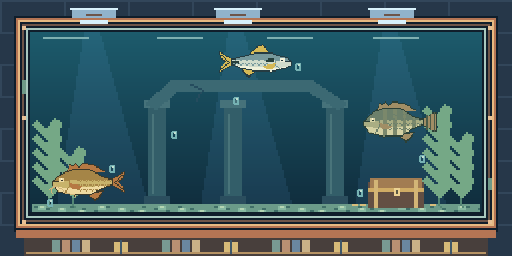

# Decorações do aquário

Coleção inicial proposta e implementada em 23/10/2026, sobre a versão da PR #5 em `9d5d7831752b79f5578007bb51b255329c15cfd0`. Branch de trabalho isolada: `codex/decoracoes-aquario-20261023`.

## Usar

- **Loja → Decorações do aquário:** aba própria no seletor existente, filtros por área/tipo, preços crescentes e prévia sem compra.
- **Museu → Decorar aquário:** colocar ou retirar o que já foi adquirido; acesso à loja.
- Cada compra é permanente e já coloca o item. Pode-se combinar uma decoração por tipo, em **sete tipos independentes**.
- Trocar/retirar é gratuito. Restaurar o visual original mantém todas as compras.
- As decorações ficam atrás dos peixes, sem alterar o limite de três espécies, comprimentos ou animações.
- Itens apenas visuais: sem multiplicador de moedas, chances de captura, tempo ou renda offline.
- **Fashionista mantém os 84 cosméticos vendidos do catálogo anterior.** As decorações usam catálogo/inventário próprios e não ampliam essa exigência.

## Catálogo e preços iniciais propostos

Os valores abaixo estão configurados no jogo e podem ser revisados pelo proprietário. Moedas inteiras.

| Área | Tipo | Opções e preços |
|---|---|---|
| Interna | Substrato | Cascalho do rio — **150**; Areia clara — **400**; Seixos de jade — **1.000** |
| Interna | Plantas | Ramos de elódea — **250**; Samambaias aquáticas — **650**; Jardim de lótus — **1.800** |
| Interna | Painel de fundo | Painel de pedras — **350**; Floresta de algas — **1.200**; Ruínas submersas — **3.200** |
| Interna | Ornamento | Conchas polidas — **300**; Baú do explorador — **1.500**; Portal de coral — **4.500** |
| Externa | Moldura | Madeira de deriva — **400**; Cobre envelhecido — **1.400**; Mármore azul — **3.500** |
| Externa | Base | Bancada de carvalho — **600**; Estante do navegador — **2.200**; Pedestal real — **6.000** |
| Externa | Iluminação | Luz âmbar — **700**; Luz de safira — **2.000**; Aurora boreal — **5.500** |

Total opcional da coleção: **37.600 moedas**. Não é necessário comprá-la para progredir ou desbloquear conquistas existentes.

## Referência de progressão e de preços

A conferência do catálogo anterior encontrou **84 cosméticos vendidos**, de **100 a 25.000 moedas**. Exemplos de referência: Boné azul 150, Colete verde 250, Gatinho 1.500, Manto estelar 3.500, Robô explorador 6.000; acessórios começam em 10.500.

- Entrada em 150–700: próxima dos primeiros cosméticos e das compras avulsas de melhoria.
- Faixa intermediária em 1.000–2.200: acompanha bonecos, roupas e bandeiras intermediárias.
- Destaques em 3.200–6.000: próximos de cosméticos de maior preço, abaixo dos acessórios especiais.
- Primeira melhoria de vara ou barco: duas peças de 30 = **60 moedas**. Custo total de um equipamento do nível 0 ao 10, sem peças iniciais: **9.450 moedas**, pela regra existente `(2+nível) × (30+20×nível)`.
- Os preços de upgrades, peixes e cosméticos anteriores permaneceram iguais.

Foi calculada também uma referência matemática usando as funções reais `probabilities` e `reward`, **somente na Enseada**, mantendo mapa/período/equipamento fixos. A espera média usada é `15/(1+0,15×vara)+1,5` segundos por ciclo:

| Vara / barco | Faixa teórica por hora, entre os sete períodos |
|---|---:|
| 0 / 0 | 734,17–1.560,99 |
| 3 / 3 | 1.636,32–4.228,46 |
| 10 / 10 | 4.845,49–16.456,09 |

Essa conta é uma média de contexto fixo, **não uma simulação de progressão, previsão de duração, mediana de ganhos ou resultado offline**. Não inclui mudanças de horário/equipamento nem decisões de compra. Não foi extrapolada para outros mapas. Os dados completos estão em [referencia-precos.json](referencia-precos.json). O principal vínculo dos preços propostos é o catálogo já vendido, evitando criar uma faixa de luxo acima dos acessórios atuais.

## Persistência e compra

Registro opcional `museu.decoracao`, com versão interna 1:

```json
{
  "version": 1,
  "compradas": [],
  "equipadas": {
    "substrato": null, "plantas": null, "fundo": null, "ornamento": null,
    "moldura": null, "base": null, "luz": null
  }
}
```

O schema geral do piloto continua 4, com o marcador existente. Saves sem esse campo continuam válidos e mostram o cenário original. O campo só é criado ao comprar, equipar ou restaurar explicitamente; a renderização/prévia não escreve estado. A carga existente preserva campos adicionais e a gravação já serializa o snapshot completo, com backup e escrita atômica; a validação do museu agora inclui a decoração quando presente.

As transações clonam o estado, debitam centésimos inteiros, registram a compra/seleção e só trocam o estado vivo depois de `_commit` confirmar a gravação. Compra repetida é recusada pelo núcleo; colocar um item já adquirido é gratuito. Seleções precisam ser adquiridas e corresponder ao tipo. IDs futuros desconhecidos são preservados nos dados, mas não são vendidos nem desenhados como outro item. Versões/estruturas inválidas seguem o erro de save existente; não há reset automático.

Essa integração foi revisada no código. **Não foram executados testes de gravação/reabertura, de compra ou suítes automatizadas nesta tarefa.** Nenhum save pessoal foi lido, escrito ou migrado.

## Arquivos

| Arquivo | Finalidade |
|---|---|
| `assets/aquario_decoracoes.json` | 21 itens, sete tipos, nomes, preços e descrições. |
| `pesca_aquario_decor.py` | Catálogo, validação e transações imutáveis de compra/seleção. |
| `pesca_aquario_decor_visual.py` | Cenário original e as variantes decorativas, em pixel art por código; cache limitado. |
| `pesca_aquario_decor_ui.py` | Aba de loja, filtros, prévia e editor de itens adquiridos. |
| `pesca_idle.py` | Conexão da nova aba e abertura direta da loja de decorações. |
| `pesca_museu.py` | Validação do registro opcional de decoração. |
| `pesca_museu_ui.py` | Acesso ao editor e fundo configurável, antes do desenho dos peixes. |
| `tools/preview_aquarium_decor.py` | Capturas Qt e referência aritmética de preços, com fixtures em memória. |

## Evidências e reprodução

[Loja](imagens/loja.png) · [Editor desktop](imagens/decorar-800.png) · [Editor compacto](imagens/decorar-320.png) · [Rolagem da prévia compacta](imagens/decorar-320-base.png) · [Catálogo visual completo](imagens/catalogo.png)



Prévia renderizada com Python 3.14.8/PySide6 6.11.2 disponíveis, em Windows:

```powershell
python -B tools/preview_aquarium_decor.py --out qa/decoracoes-nova-previa
```

Use uma pasta de saída inédita. O comando configura `PESCA_IDLE_SAVE_PATH`, APPDATA, LOCALAPPDATA, TEMP e TMP em QA antes de importar produto/Qt. Não inicia `JogoPesca`, não executa pescarias, não compra itens e não chama SaveStore. Saldos, descobertas e itens possuídos são fixtures em memória. As imagens são widgets reais, não mockups. Foram conferidas as 21 opções e três combinações, a loja, o museu e o editor em 800x650 e 320x568. A revisão visual corrigiu fundo claro indevido e cortes no editor compacto. Nenhum save foi criado.

## Limites da entrega

Disponível no código-fonte. EXEs/APKs anteriores não foram recompilados e não contêm esta funcionalidade. Prévia Qt desktop não comprova toque/Android, fluxo de compra completo ou persistência real; esses testes ficam pendentes de solicitação. Nenhuma alteração no RNG, catálogo de pesca, economia de recompensas, parâmetros de tamanho ou metas de coleção. A avaliação estética e eventuais ajustes dos preços permanecem com o proprietário.
