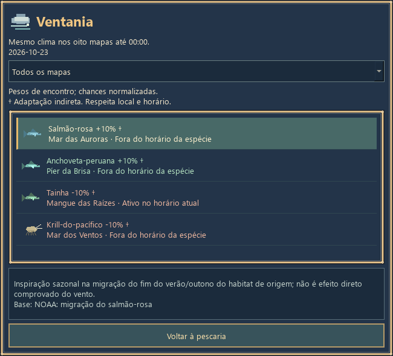
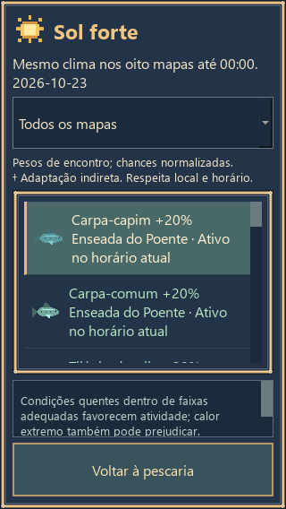
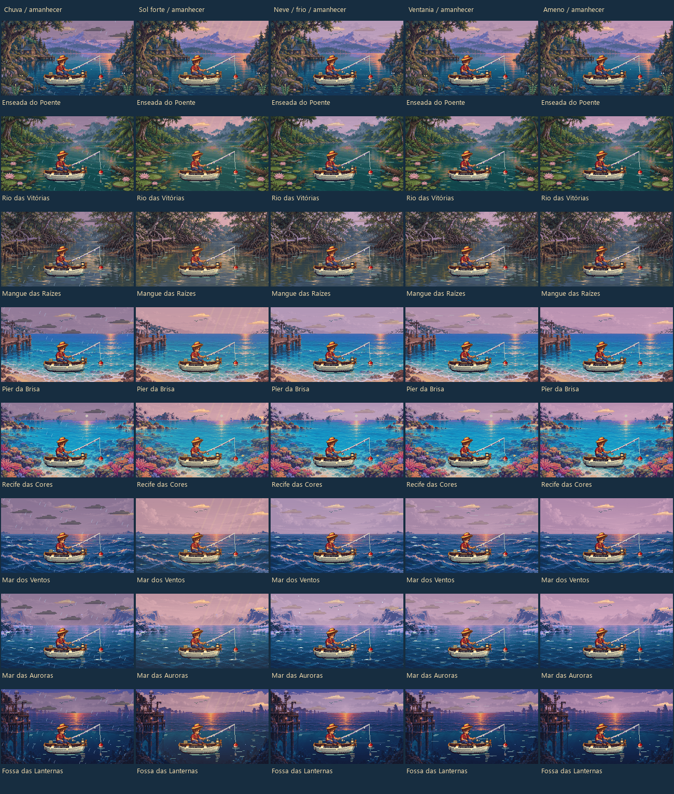
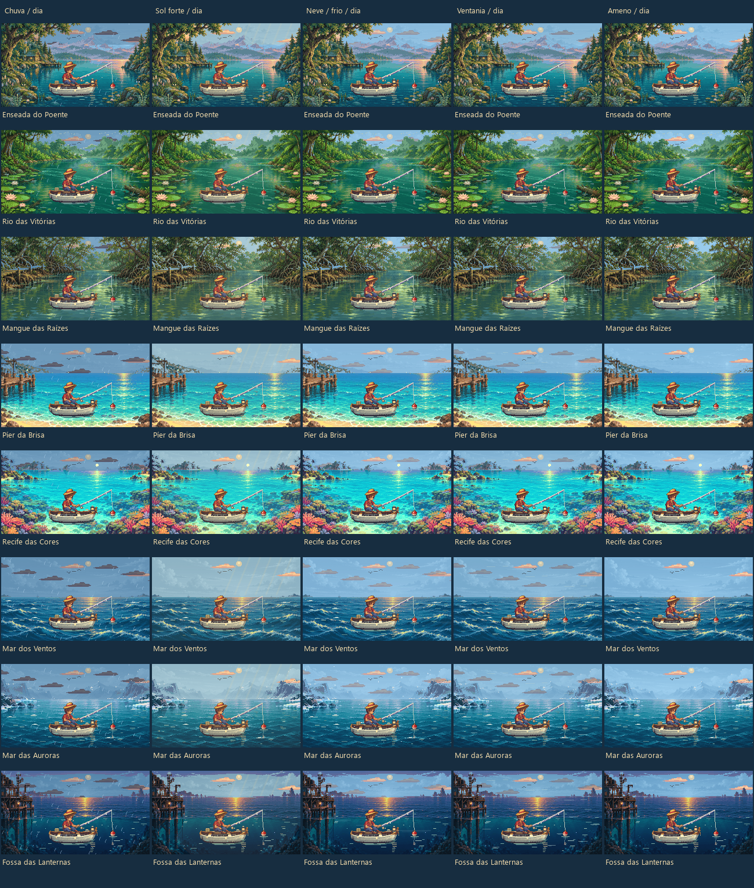
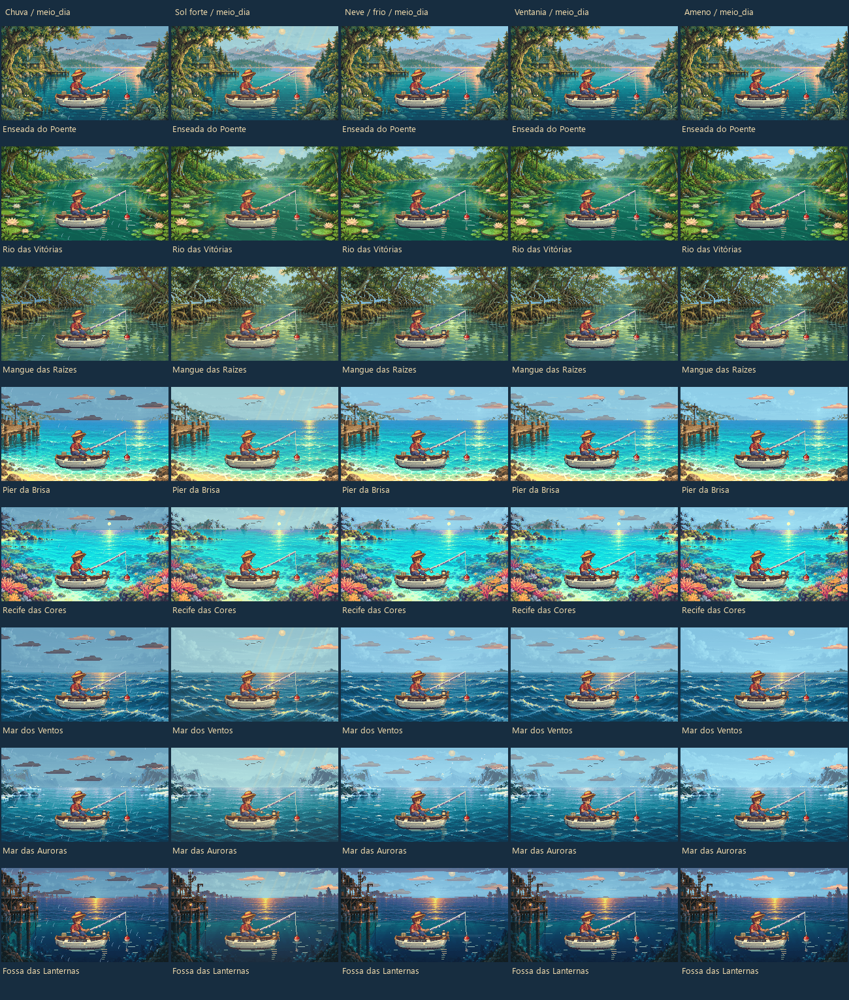
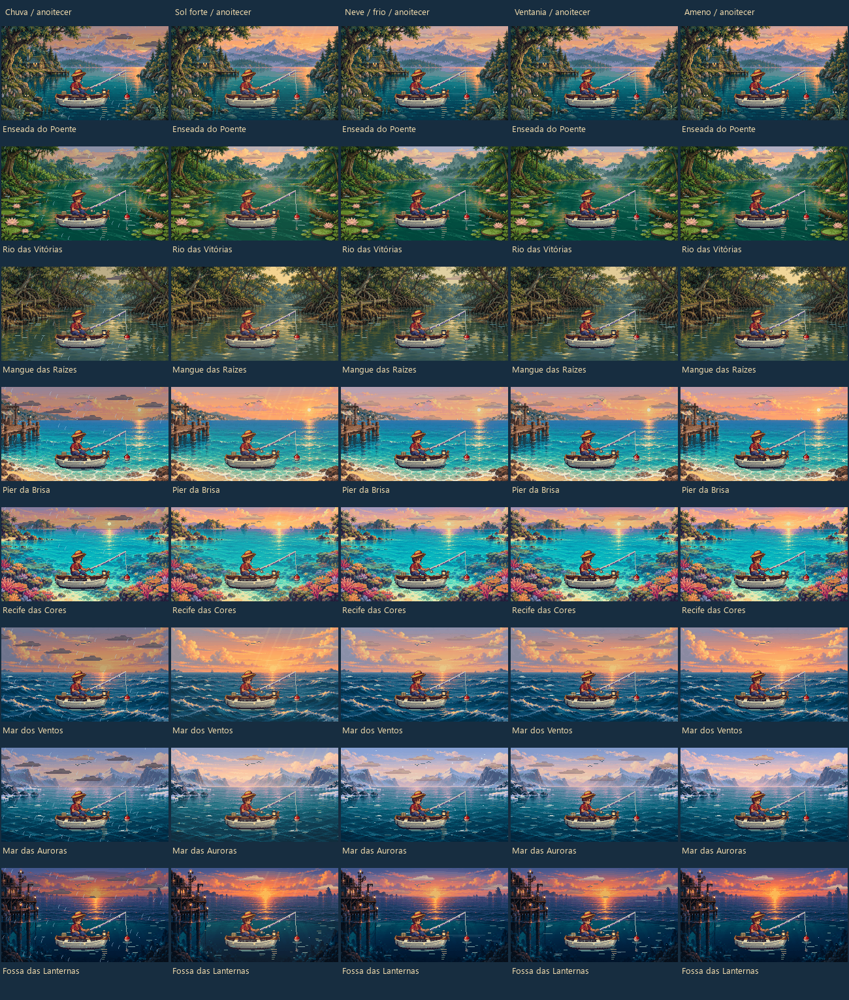
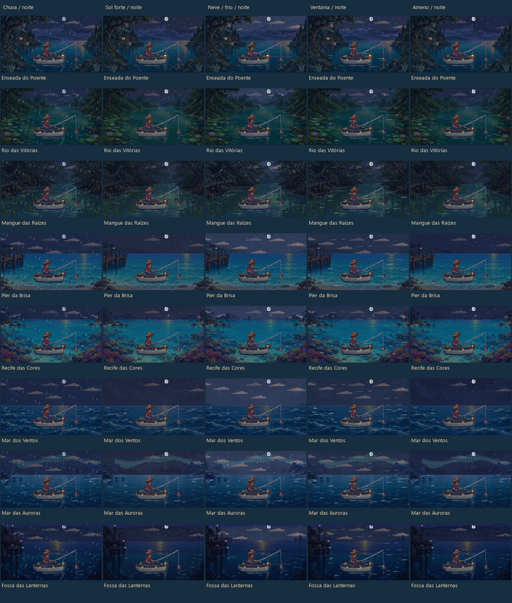

# Sistema climático - entrega de 23/10/2026

Implementado e testado localmente; publicação destinada à PR #5, em rascunho. Não houve merge na main. As evidências abaixo foram produzidas nesta tarefa com dados sintéticos, em clone isolado, sem ler saves pessoais.

## Revisões e executável

- Repositório: `BernardoJ/PescaIdle`; branch remota: `codex/piloto-tamanhos`.
- Head de partida: `c545ca652386d74372307bd6d52a91f84d1ed4a0`.
- Base da PR: `codex/android-auditoria`, `2a0353ff7c1cae2dca69d08c222b0660770d4385`.
- Commit do código compilado: `d1bcd5bb13cb58d7196221450be2a43124dfa233`; branch local `codex/sistema-climatico-20261023`.
- Executável novo: `PescaIdle-Clima.exe`, 50,561,165 bytes; SHA-256 `ba481e9a42d2e992406aaa6380575499274cff3e541e160efd32ea5cf352c0ee`.
- Build Windows x64: Python 3.14.8, PySide6/Qt 6.11.2, PyInstaller 6.22.3. Relatórios/PDF: Python 3.12.14 e ReportLab já disponíveis.
- O executável inclui os avanços anteriores desta branch: piloto, aquário, decorações e conquistas. Binários históricos foram preservados. Não é uma atualização do APK.

## Comportamento entregue

Cinco eventos diários: chuva, sol forte, neve/frio, ventania e ameno. Um calendário por perfil para os oito mapas; probabilidades nominais iguais de 20%, podendo repetir em dias consecutivos. Troca às 00:00 locais. Viajar, reabrir e consultar não rerrolam a data. Semente própria e SHA256 não consomem o RNG da pesca.

O ícone ao lado do menu é clicável e aceita teclado. O painel Clima de hoje lista bônus/ônus, porcentagens, disponibilidade atual e justificativas, com filtro por mapa. As afinidades também aparecem na enciclopédia das espécies descobertas. A consulta é somente leitura.

Foram integradas as 25 espécies aprovadas, incluindo todos os casos †, com representantes nos oito mapas. Modificadores usuais de +20%/-20%; experimentais † de +10%/-10%. São fatores de **peso**, não pontos percentuais de chance final nem percentuais biológicos. Pesos são normalizados dentro dos grupos anteriores; preços, duração de pesca, participação do lixo e encontros especiais não foram alterados. Espécies fora de mapa/horário continuam em zero. A tabela completa está em [afinidades.csv](evidencias/afinidades.csv) e as fontes/ressalvas no [catálogo](../../assets/clima_especies.json).

Peixe-lanterna-de-müller responde à luz/crepúsculo e fica neutro à noite. Chuva costeira, vento e afinidades indiretas são abstrações de jogo explicitadas com †; não há simulação de vento direcional, salinidade ou estações astronômicas. Ameno é neutro.

Efeitos originais em Qt: chuva com impactos; luz quente/reflexos; flocos no Mar das Auroras e atmosfera fria nos demais mapas; vento com espuma e movimento ambiental. Sol forte não desenha sol durante a noite. Pixels lógicos, máscaras de mapas e personagem foram mantidos. [Animação dos cinco eventos](imagens/climas.gif).

## Persistência, captura e offline

Schema 5, marcador `tamanhos-v1` preservado. Migração de v1-4 com backup e escrita atômica pelas rotinas existentes; v5 é idempotente. Saldo, inventário, cosméticos, conquistas e medidas preservados nos testes sintéticos. Clima/data/equipamento ficam congelados no início da fisgada; meia-noite, viagem, pausa ou reabertura não duplicam nem rerrolam a recompensa.

Antes da ativação climática, capturas/offline anteriores usam modo legado neutro; não foi inventado clima histórico para saves antigos. Offline percorre os horários históricos, limitado ao primeiro trecho de até quatro horas da ausência; expedição substitui a janela, sem renda paralela ou tempo futuro. Replay usa offset salvo como antes; não reconstrói mudanças históricas de horário de verão.

O EXE usa `perfil-piloto/save.json` junto dele, sem importar APPDATA. Se já houver perfil piloto ali, será migrado com backup. Um EXE antigo não abre schema 5; para voltar, é necessário restaurar uma cópia do backup anterior. Não executamos migração sobre o save do jogador.

## Verificações executadas agora

| Grupo | Resultado observado |
|---|---|
| Contratos novos | 14 testes; calendário, meia-noite, offsets, migração, idempotência, pending, RNG, offline e expedição |
| Regressão existente | 83 unitários: 44 conquistas, 17 tamanhos/pendências, 11 auditoria, 11 museu |
| Matriz de probabilidades | 3.080 contextos: 8 mapas x 7 períodos x 5 climas x 11 níveis de vara; zero erros de direção e zero bônus/ônus anulados |
| Economia por contexto | 33.880 combinações, acrescentando 11 níveis de barco; preços e limites preservados |
| Expansão/cosméticos | 5.920 verificações da expansão e 1.359 de cosméticos passaram |
| Arte | 280 cenas + 1.120 quadros adicionais; sete pranchas, um GIF com 48 quadros/240 cenas |
| Interações | 7.360 renders de itens individuais e 4.840 de pares vara/barco; 50 ciclos de diálogo sem timers vivos nem alteração de estado/RNG |
| Interface | 45 filtros; clique, teclado, viewport mobile 320x568, legibilidade e ausência de sobreposição do ícone |
| Windows EXE novo | Três processos passaram: salvar pendência, entregar e reabrir; schema 5, prêmio único e consulta clicável |

Desempenho observado offscreen: p95 entre 1,61 e 2,64 ms por cena nesta máquina. Isso não é benchmark de telefone ou garantia de FPS no dispositivo final. A regressão de conquistas mantém um campo histórico `base=d8032d6` no seu JSON; ele não identifica o código executado nesta rodada. Os hashes em [manifesto.json](evidencias/manifesto.json) identificam os arquivos efetivamente testados e compilados.

Durante a validação foram corrigidos recortes/contraste do painel e sobreposição do ícone na prévia mobile. Duas expectativas antigas de schema 4 foram atualizadas para a constante atual, mantendo as demais verificações de moeda/integridade. Nenhum teste de segurança foi removido.

## Estudo delimitado de progressão

Motores reais em processos separados: versão de partida, candidato em ameno e candidato com calendário. São 35 condições iniciais (7 horários x 5 sementes explícitas, 2026102300-2026102334), 2 políticas de consulta, 24h online por execução, 3 modos: **210 execuções e 2.383.508 eventos reais**. Data inicial 23/10/2026, UTC-03. As decisões usam renda esperada disponível, sem conhecimento de capturas futuras. Upgrades imediatos; cosméticos não são comprados: mede-se somente saldo suficiente para eles após upgrades.

**Base e ameno coincidiram exatamente** nos 70 pares: sequência ordenada, RNG final, inventário, moeda, equipamento e marcos. Com clima ativo:

| Medida pareada | Consulta a cada 3h | Consulta a cada 30min |
|---|---:|---:|
| Média das variações relativas de renda | -0,976% | +0,021% |
| Mediana da diferença de renda (moedas) | 0,00 | +826,10 |
| Média da diferença de renda (moedas) | -35.312,29 | +777,02 |
| IC95 aproximado da diferença média (moedas) | -70.837,33 a +212,76 | -1.018,73 a +2.572,77 |
| Diferença média de espécies descobertas | +0,314 | +0,200 |
| Diferença média de espécies com 10 registros | +0,571 | +0,457 |

Os dois intervalos de renda incluem zero e são condicionados a apenas 35 pares por política. Não demonstram ausência de efeito ou um limite universal. O arquivo [comparacao.json](evidencias/comparacao.json) contém médias, medianas, extremos, marcos atingidos e intervalos; [progressao-210.csv](evidencias/progressao-210.csv) contém as sementes e métricas por execução.

A consulta mais frequente teve vantagem média relativa de renda de **2,904% na base e 4,058% com clima**, mas descobriu menos espécies (-5,339%/-5,576%). São heurísticas econômicas, não estratégias ótimas de coleção; a consulta não implica viagem em toda decisão. Não é possível concluir que trocar seja necessário para jogar bem. Vale acompanhar essa vantagem em um estudo maior antes de qualquer novo balanceamento.

Nos cálculos de contexto fixo, a renda esperada por fisgada variou entre **-13,929% e +11,782%**. Isso é consequência de redistribuir encontros com valores diferentes, não de mudar preços. Esse cálculo não substitui a progressão de 24h, nem mede a conclusão integral. Não foram refeitas as 10.000 simulações antigas; seus tempos não são validados para o clima novo.

## Arquivos e reprodução

- Regras: `assets/clima_especies.json`, `pesca_clima.py`, integração pequena em catálogo/motor/save.
- Interface/arte: `pesca_clima_ui.py`, `pesca_clima_visual.py`, HUD, menu, enciclopédia e adaptação mobile.
- Empacotamento: spec/entrypoint para EXE novo e smoke isolado. Binários históricos inalterados.
- Testes: sete ferramentas climáticas/worker, contratos e atualização de duas expectativas de schema existentes.
- Documentação/evidências: este relatório, guia, CSV/JSON agregados, imagens, GIF, PDF e manifesto de hashes. Nenhum save, cache ou ambiente publicado.

Os comandos exatos de validação, comparação e build estão no [guia](../CLIMA.md); usam pastas novas em `qa/`, ignoradas pelo Git. Para recriar apenas este relatório a partir das saídas existentes: `python tools/report_climate.py --package` e, com ReportLab disponível, `python tools/report_climate.py --pdf`. Não importam o produto.

## Limites e pendências

Android nativo/APK não compilado nem testado nesta tarefa. GUI verificada por imagens de renderização Qt real e smoke automático do EXE, sem sessão humana longa ou teste de todos os dispositivos. Todas as combinações finitas da matriz indicada foram cobertas; não todas as datas, falhas de hardware, fusos/DST históricos ou combinações simultâneas de cosméticos. O estudo não mede offline de longo prazo, conclusão de todos os objetivos, retenção, museu completo nem ótimo global. A migração foi testada somente em fixtures sintéticas. Não houve instalação de dependências, mudança de segurança, visibilidade, merge ou release.

## Evidências gráficas

