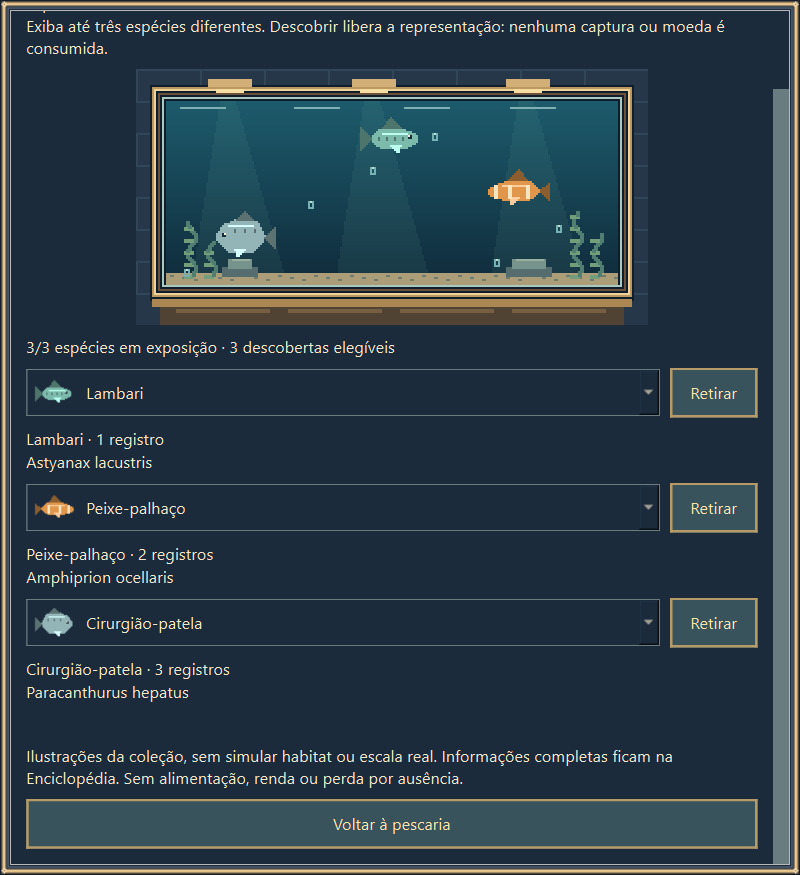
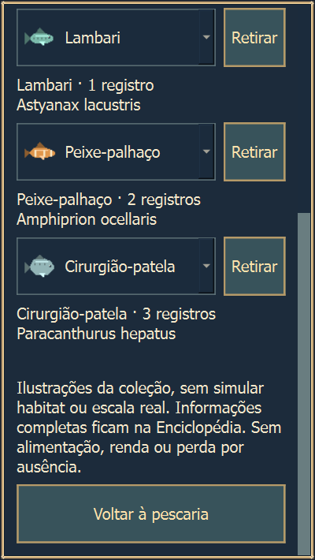

# Etapa 6A - Fase 1: inspeção e proposta de varas

**17/10/2026. Aguardando aprovação do desenho. Nada do piloto foi implementado.**

## 1. Base identificada e preservação

Foi lido integralmente `PescaIdle-prompt-etapa-6A-piloto-varas.txt`, incluindo a parada obrigatória da Fase 1. Foram conferidos README, relatório/manifesto do museu, contratos de save/offline, fontes do sorteio e ferramentas de validação. Nenhum `AGENTS.md` ou skill local aplicável foi encontrado nos caminhos inspecionados.

Base efetiva: branch `codex/museu-aquario-inicial`, commit **`2a0353ff7c1cae2dca69d08c222b0660770d4385`**, árvore `19e34376e09369b90933ce34f5fac5113e15fbc1`. Diretório de origem: `../PescaIdle-museu-20261015`. O museu está de fato presente nos módulos, menus e save; os 36 hashes do manifesto anterior coincidiram. A origem estava limpa, sem arquivos relevantes não rastreados. O checkout Desktop permanece na branch gráfica antiga, em `9103404`; não foi usado como base.

Remoto verificado, somente por leitura: `https://github.com/BernardoJ/PescaIdle.git`. A branch remota `codex/android-auditoria` também estava em `2a0353f`; `main`, em `6b29b4a`. O relatório antigo que dizia “museu sem commit/local” é um registro de 15/10, anterior ao commit e ao push já realizados. Nenhuma publicação foi feita nesta Fase 1.

| Artefato de preservação | Conteúdo e conferência |
|---|---|
| `preservacao/projeto-museu-2a0353f.zip` | 390 arquivos rastreados, incluindo fontes, recursos, evidências e PDF; 121.843.452 bytes descompactados; cópia dos bytes reais da pasta |
| `preservacao/historico-2a0353f.bundle` | Histórico Git completo até a base; `git bundle verify` aprovado |
| `preservacao/manifesto-preservacao.json` | Caminhos relativos, tamanho e SHA256 de cada arquivo, base/árvore/remoto, sete checkouts e hashes dos artefatos |
| `preservacao/museu-commit-2a0353f.patch` | Diff binário completo do commit do museu contra `f594668`; não depende de arquivos novos não rastreados |
| `preservacao/alteracoes-rastreadas.patch` e `indice.patch` | Vazios, porque a base já estava commitada e limpa |
| `preservacao/museu-patch-anterior-20261015.patch` | Patch histórico preservado; SHA256 `148f779b611183e97012b6e5f2bb5f04e85db20f0e95dc9fd3e33961c14b97cc` |
| `snapshot-verificado/` | Reconstrução independente pelo bundle + restauração dos bytes do ZIP; 390 hashes idênticos, mesmo HEAD/árvore e Git limpo |

A primeira conferência do clone sinalizou diferenças de metadados de fim de linha após restaurar CRLF. O índice **apenas da cópia** foi atualizado com `add --renormalize`; a árvore continuou exatamente igual à base, sem commit ou alteração de conteúdo. Os sete checkouts originais e suas branches foram preservados. Arquivos ignorados, ambientes virtuais, credenciais e perfis pessoais não entraram no ZIP. O save pessoal não foi lido nem copiado.

## 2. Validações executadas agora

Ambiente reutilizado: Windows 11 26100, Python 3.14.8, PySide6/Qt 6.11.2, Pillow 12.3.0, otimização Python desligada. Nenhuma dependência foi instalada. Execuções aconteceram em `snapshot-verificado`, com `PESCA_IDLE_SAVE_PATH`, `APPDATA`, `LOCALAPPDATA`, `TEMP`, `TMP` e diretório de QA explícitos antes da inicialização; as ferramentas também criam seus perfis sintéticos. Saídas ficaram em `qa/`, sem sobrescrever referências da base.

| Execução desta fase | Resultado observado |
|---|---|
| `validate_game.py` | Aprovado: 11 testes de auditoria, 11 do museu, 5.920 verificações da expansão, 1.359 de cosméticos e balanceamento de 168 pools + sete inícios × 30 sementes |
| `validate_mobile.py` | 15 verificações aprovadas: prévia desktop de toque/orientação/retomada; não é teste de APK |
| `validate_museum.py --native-visual` | Três testes aprovados em Windows 100% e novamente em 125% |
| Ciclo de vida do museu | 50 aberturas/fechamentos, sem diálogos/timers retidos; persistência, referências inválidas, erro de escrita, recuperação e idempotência cobertos pela suíte |
| Conferência adicional de rolagem | Rodapé completo e botão de saída acessíveis em 640×700, 320×568 e 360×800 a 125%; Escape interrompe o timer; lock temporário liberado |
| `measure_museum_baseline.py` | 210 progressões, 90 perfis fixos e 90 comparações de retorno; resultados de progressão, perfis e retornos exatamente iguais aos registros anteriores, agora reproduzidos com o museu |
| Android nativo/aparelho, novo EXE/APK | Não executados nesta fase; nenhum binário foi gerado ou substituído |

A primeira execução da suíte terminou com código **0**, mas a impressão final do wrapper falhou por codificação CP1252 do console. Isso não foi uma falha do jogo: os JSONs registraram aprovação. O wrapper externo passou a usar UTF-8 e a suíte foi repetida, encerrando sem erro. Nenhum teste ou código de produção foi alterado para obter aprovação. Não foi encontrada falha impeditiva de save, recompensa, captura ou museu nesta linha de base.

Comandos reproduzíveis, a partir desta pasta e usando o Python indicado em `executar_verificacao.py`:

```powershell
python executar_verificacao.py suite nova-suite
python executar_verificacao.py mobile nova-mobile
python executar_verificacao.py native100 nova-native100
python executar_verificacao.py native125 nova-native125
python executar_verificacao.py measure nova-medicao
```

Use nomes novos para não sobrescrever evidências. `execucao.json` registra comando, cwd, overrides e código de saída. `qa/measure/ritmo.json` contém as corridas completas. `verificar_rolagem.py` foi executado uma vez; cria sua própria saída exclusiva.





As imagens foram inspecionadas visualmente. São capturas estáticas reais de widgets Qt com dados sintéticos; a segunda não é evidência de telefone físico. O corte no topo dessas imagens é o resultado da rolagem para revelar o rodapé.

## 3. Desenho proposto: duas especializações e opção neutra

**Todos os parâmetros abaixo são propostas, ainda sem aprovação.** Piloto restrito à **Enseada do Poente**, ID `enseada_do_poente`. Os níveis 0-10 da vara, peças, velocidade de pesca e recompensa por espécie continuam iguais. A especialização é uma escolha mecânica separada da aparência.

| Opção | Intenção e grupo favorecido | Peso do grupo Frequentes | Peso do grupo Alvos |
|---|---|---:|---:|
| Neutra, ID `neutra` | Manter o comportamento atual, sem viés adicional | ×1,00 | ×1,00 |
| **Vara de Fluxo**, ID `fluxo` | Procurar mais registros do grupo que já tem maior peso-base, por exemplo Carpa-comum para a Enciclopédia | **×1,25** | **×0,85** |
| **Vara de Precisão**, ID `precisao` | Procurar os quatro alvos de menor peso, por exemplo o Pacu que falta na coleção | **×0,90** | **×1,50** |

Os dois grupos são listas de IDs fixas deste desenho, verificadas contra as ocorrências da Enseada. “Frequentes” descreve peso de jogo; não é uma afirmação biológica. Não serão inferidos atributos de alimentação, tamanho ou habitat.

| Grupo | IDs existentes | Critério verificado nesta base |
|---|---|---|
| Frequentes | `lambari`, `tilapia_do_nilo`, `carpa_comum`, `acara` | Categoria `peixe`, ocorrência na Enseada, peso-base ≥3 |
| Alvos | `pacu`, `carpa_capim`, `traira`, `jundia` | Categoria `peixe`, ocorrência na Enseada, peso-base <3; os quatro têm raridade `Raro` |

O Pacu é `Raro`, mas tem `rod_bonus=false` na base; isso permanece. A classificação de raridade, o bônus atual de nível, o valor em moedas e o fator da especialização são conceitos distintos. Nomes e IDs aprovados não dependerão de descobrir todos os integrantes.

### Fórmula e limites

Primeiro filtrar espécie, mapa e período elegíveis. Para cada peixe elegível `i`:

```text
w_i = peso_ocorrencia_i × preferencia_periodo_i
      × (1 + 0,15 × nivel_vara, se rod_bonus; caso contrário 1)
a_i = w_i × fator_da_especializacao_para_o_grupo_i
P_i = parcela_peixes × a_i / soma(a_j dos peixes elegíveis)
```

Manter as parcelas de lixo e encontros especiais exatamente como hoje, com normalização separada de cada categoria. Na Enseada atual não há especiais elegíveis: lixo permanece 4% e peixes, 96%. Fora da região piloto, o cálculo é exatamente neutro, embora a escolha fique guardada. Espécie indisponível continua com chance **zero**; nenhum fator cria ocorrência, aumenta o valor de venda, concede captura extra, acelera espera/fisgada ou muda o horário. Todos os fatores são positivos: permanecem as rotas existentes para obter todas as espécies, sem pool vazio ou novo bloqueio de coleção.

**×1,50 no peso não significa +50% na probabilidade final.** No período Manhã e vara/barco 1, a chance do Pacu seria 7,3846% com Neutra, 5,1483% com Fluxo e 11,7073% com Precisão. O aumento redistribui a parcela dos peixes; não se soma probabilidade por fora.

### Quando escolher e contrapartidas

- **Fluxo:** ajuda a procurar Lambari, Tilápia-do-nilo, Carpa-comum e Acará. Reduz a chance dos quatro Alvos; pode atrasar sua coleção e diminuir a renda quando Traíra/Jundiá são elegíveis. Não promete mais diversidade nem mais capturas totais.
- **Precisão:** ajuda a procurar Pacu, Carpa-capim, Traíra e Jundiá nos horários permitidos. Reduz a chance dos Frequentes e pode piorar a renda quando o alvo disponível vale pouco. Não muda a raridade cadastrada nem dá garantia contra azar.
- **Neutra:** mantém o equilíbrio atual quando o jogador quer evitar favorecer um desses grupos e, em comparação com cada especialização, preserva melhor as chances do grupo que aquela penaliza. Não precisa ser a melhor renda em cada horário. Nas outras sete regiões, as três escolhas são equivalentes ao comportamento anterior.

Cada foco pode ficar equipado durante uma sessão inteira ou ausência; nenhum bônus exige alternância constante, retorno frequente, consumível, manutenção ou punição por manter a escolha.

### Desbloqueio, custo e troca propostos

Ambas liberam permanentemente ao alcançar **vara nível 1**, sem exigir uma nova região, conquista ou compra. Custo de desbloqueio **0 moedas**; equipar/trocar também **grátis**, reutilizável e sem cooldown. Quem já tem nível ≥1 recebe acesso às duas, mas começa com **Neutra**. Nenhum nível, peça, compra, dinheiro, cosmético ou conquista é convertido, perdido ou cobrado novamente. Estas opções não são cosméticos vendidos e não entram na meta Fashionista.

### Texto previsto da interface, ainda não implementada

Reaproveitar o diálogo de status com acesso “Especialização da vara”, controles atuais, descrição e confirmação por botão; sem alterar a loja de cosméticos ou o desenho do museu.

- Neutra: **“Sem ajuste de pesos. Mantém a pesca atual.”**
- Fluxo: **“Na Enseada, favorece Lambari, Tilápia-do-nilo, Carpa-comum e Acará: pesos ×1,25. Pacu, Carpa-capim, Traíra e Jundiá: ×0,85. Não aumenta o total de capturas.”**
- Precisão: **“Na Enseada, favorece Pacu, Carpa-capim, Traíra e Jundiá: pesos ×1,50. Os outros quatro peixes: ×0,90. A chance final depende do período e da normalização.”**
- Requisito/custo: **“Vara Nv. 1 · desbloqueio e troca grátis.”**
- Botão: **“Equipar para a próxima fisgada”**. Status: **“Equipada: Precisão · próxima fisgada”**; havendo pendência, mostrar separadamente **“Fisgada em andamento: Neutra; resultado preservado.”**
- Em outra região: **“Precisão equipada · sem efeito nesta região.”** Confirmar **“Trocar é grátis. A fisgada atual e seu tempo restante não serão alterados.”**

Nomes dos grupos/espécies e acesso ao catálogo serão legíveis antes da escolha; a apresentação não revelará informações bloqueadas da Enciclopédia. Teclado, foco, texto longo e prévia de toque serão validados na Fase 2.

### Save, fisgada e retorno propostos

Proponho **schema global 4**, com backup exato do v3 antes da primeira gravação migrada. Isso evita que executáveis antigos abram um perfil com uma mecânica que ignoram. O objeto mínimo proposto é:

```json
"especializacao_vara": {
  "version": 1,
  "equipped_id": "neutra",
  "unlocked_ids": ["neutra"]
}
```

Migração v1/v2/v3 será determinística e idempotente: Neutra selecionada; adicionar `fluxo`/`precisao` aos desbloqueios se vara ≥1, sem taxa/recompensa. Desbloqueios adquiridos ficam permanentes. Campos extras, museu, saldo, peças, compras, IDs, inventário e conquistas são preservados. Não adicionar especialização a capturas antigas. Uma pendência anterior continua com o mesmo contexto/resultado; ausência de campo nessa pendência significa execução legada, sem escrever um histórico inventado.

IDs funcionais desconhecidos, objeto inválido, opção bloqueada equipada ou versão futura serão erros visíveis: bloquear uso/gravação e preservar o arquivo, sem cair silenciosamente em Neutra. Campos extras sem semântica funcional continuam preservados. Recuperação de backup continua dependendo de consentimento. Falha de gravação não aplica a troca parcialmente; mantém o snapshot durável e pausa com erro, como hoje.

Na nova fisgada, congelar ID selecionado, ID efetivamente aplicado (`neutra` fora do piloto), versão da regra, local/período/horário/níveis e resultado, na transação existente. Não alterar espera já iniciada nem consumir RNG para exibir chances, ícones ou descrição.

Ordem obrigatória: **processar a ausência/retomada com o estado salvo → reconciliar o tempo ativo até o clique → copiar esse estado → gravar a escolha → aplicar somente ao início da próxima fisgada**. Se uma captura começou antes de confirmar, ela conserva resultado, contexto e tempo restantes. A escolha vale para as futuras capturas da próxima ausência; não se inventam trocas durante ela. Preservar primeiro trecho de quatro horas, pausa, expedição substitutiva, recompensa única e watermark. Não recalcular o passado com a escolha feita no retorno.

## 4. Comparação isolada e diferença entre manhã/noite

`comparar_proposta.py` fez **contas de desenho**, sem alterar, substituir ou monkey-patchar o motor. Conferiu 1.848 combinações (8 mapas × 7 períodos × 11 níveis × 3 opções): mesmos IDs elegíveis, massa finita normalizada, pesos positivos, parcelas de categoria preservadas e igualdade exata fora do piloto/na opção neutra. Também amostrou 30 sementes, 100 resultados em pool fixo, sete períodos e níveis 0/3/10: 1.890 cenários. Nível 0 é análise matemática, não uso permitido antes do desbloqueio. Esse exercício não comprova implementação ou offline das novas opções.

Exemplo analítico com **vara/barco 1**, período mantido fixo; não é previsão de uma hora de calendário atravessando períodos:

| Período / opção | Chance conjunta dos Alvos | Moedas/h esperadas |
|---|---:|---:|
| Manhã / Neutra | 7,38% | 999,52 |
| Manhã / Fluxo | 5,15% | 1.021,14 |
| Manhã / Precisão | 11,71% | 957,72 |
| Noite / Neutra | 22,53% | 2.287,09 |
| Noite / Fluxo | 16,56% | 1.870,77 |
| Noite / Precisão | 32,47% | 2.980,75 |

Os grupos têm interesses opostos; Precisão não domina a renda em todos os cenários, e Fluxo reduz a obtenção dos Alvos. A contagem total esperada não muda, pois tempos e parcelas de categoria são os mesmos. A diversidade depende dos peixes que faltam: em 100 resultados e nível 3, as medianas foram cinco espécies para as três opções tanto de manhã quanto à noite; não há evidência para prometer “mais variedade”. Os JSONs exportam probabilidades, mínimos/p10/mediana/p90/máximos, renda, contagens por grupo e diversidade por semente.

**A diferença histórica foi reproduzida antes do piloto:** manhã (07:00-11:00) alcançou barco 10 em 0/30 corridas; noite (20:00-00:00), 30/30, mediana 132,8 min. Política: quatro horas na Enseada, compras imediatas alternando níveis completos de vara e barco, sem viajar/cosméticos; resultados não alcançados são censurados. Manhã/dia oferecem Pacu de 0,5 moeda e nenhum peixe com `rod_bonus`; noite oferece Traíra de 24 e Jundiá de 28, ambos com bônus crescente por nível. Isso aumenta a renda e retroalimenta as compras nessa política fixa. Não é evidência isolada de bug nem comparação entre estratégias humanas. O catálogo e seus horários não foram alterados.

Risco explícito: Precisão amplia ainda mais a renda noturna (cerca de +30% neste exemplo) e a diferença já existente; pela manhã pode reduzi-la. Fluxo faz a troca inversa. São valores iniciais para seu aceite, sem promessa de duração da progressão. Não houve ajuste silencioso dos pesos/preços globais para uniformizar horários.

## 5. Aceitação prevista para a Fase 2, não executada

Após aprovação, implementar apenas esse piloto em outro espaço isolado e comparar: base neutra preservada, nova Neutra e as duas opções. Reutilizar sementes 0-29, sete inícios, mesmos mapas/níveis/políticas; separar progressão de perfis fixos e censurar marcos incompletos.

Testar: fórmulas/pools/obtenção, desbloqueio permanente e zero cobranças, cliques e trocas repetidas, troca antes/durante/depois da fisgada, pending/reopen/suspensão, recompensa única, nenhuma alteração de espera, save v1-v4/idempotência/IDs/versões inválidas/erros de gravação/lock/backup/recuperação, museu 0/1/3 espécies, retorno 1/4/8 h/parcelado/pausa/expedição e UI Windows 100%/125%/teclado/mobile. Comparar RNG/economia exatamente dentro do mesmo cenário, com tolerâncias temporais explícitas quando justificadas; não exigir capturas iguais entre especializações diferentes. Alteração material dos parâmetros medidos exigirá novo aceite.

Pendências: o piloto, migração v4 e sua UI não existem; testes comportamentais deles e Android nativo não foram executados. A Fase 1 não promete ausência de todo defeito ou certificação de distribuição. Não houve novos builds, alterações de produção, commits, push, merge ou mudança de PR.

**Você aprova estes efeitos, desbloqueios, custos, região piloto e regras de troca/save para implementar apenas este piloto?**
