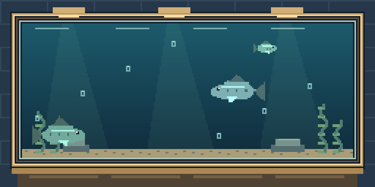
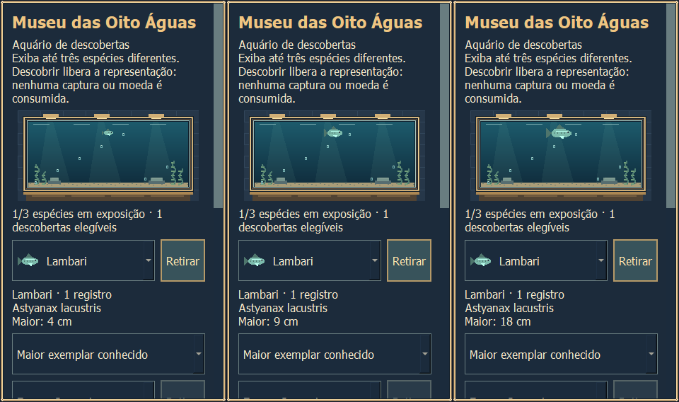
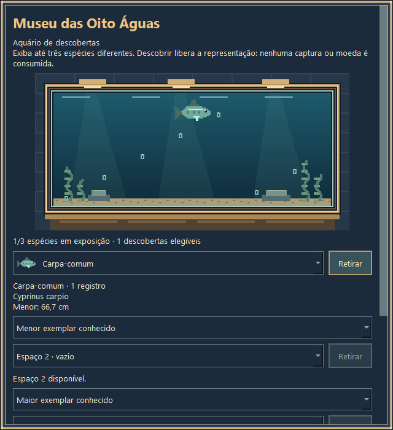

# Piloto de tamanhos — publicação para revisão

Publicação autorizada após a entrega local de 18/10/2026. Esta página descreve a estrutura do repositório; o relatório local mantém seu layout histórico com caminhos privados removidos.

## Identificação

- Repositório: **BernardoJ/PescaIdle**.
- Branch: **codex/piloto-tamanhos**.
- Base do PR: **codex/android-auditoria**, commit **2a0353ff7c1cae2dca69d08c222b0660770d4385**, que já contém o museu.
- Código do candidato na raiz, com os 16 arquivos revisados da entrega local. Nenhuma nova mecânica, rebalanceamento ou integração com as varas foi acrescentada para publicar.
- Snapshot de fontes/assets testados: `3118f7966ad9a3070a06cd81796709b39927b31e12064f8edc45521f038bc8d9`.
- Nenhum merge, release, deploy, mudança de visibilidade ou permissões foi realizado.

## Executável Windows

**[Baixar PescaIdle-Tamanhos-Piloto.exe](https://github.com/BernardoJ/PescaIdle/raw/refs/heads/codex/piloto-tamanhos/PescaIdle-Tamanhos-Piloto.exe)**

Salve em uma pasta gravável e dê dois cliques. O perfil do piloto fica em `perfil-piloto/save.json`, ao lado do EXE; ele começa vazio e não lê o perfil pessoal em APPDATA. Um caminho de save explícito fora da pasta do candidato é recusado.

- Tamanho: **50.200.863 bytes**.
- SHA-256: `4229707d91ed82b519178e18ea6143cc8a86b3e164f02aaf5826abce32eaff27`.
- Build e smoke observados na entrega local de **18/10/2026**. O binário publicado é o mesmo, conferido por hash; não foi recompilado para este push.
- `PescaIdle.exe` antigo e APKs anteriores foram preservados e não representam este piloto.

Para retornar ao jogo anterior, feche o piloto e abra seu executável original. Não copie o save schema 4 deste candidato sobre o perfil da versão-base schema 3.

## Implementado

Lambari, Tilápia-do-nilo, Carpa-comum e Traíra recebem comprimentos inteiros em mm, mostrados em cm. Min/typ/max são parâmetros de design provisórios, sem alegação biológica; consulte a [tabela e distribuição](PARAMETROS.md). Outras espécies continuam sem medidas fictícias.

A medida é congelada no início da fisgada com regra de origem e RNG separado. Primeira captura estabelece ambos os recordes; empates não atualizam. Online/offline usam o motor existente, com limite de quatro horas e resumo agregado. As cinco conquistas de medidas não concedem bônus econômico. No museu de três espaços, o jogador escolhe menor/maior exemplar conhecido; sem medida, a representação é padrão.

Schema 4 aqui exige `pilot_kind=tamanhos-v1`; não é o schema proposto para Fluxo/Precisão. Saves antigos sintéticos são migrados com backup sem medidas retroativas. A branch não foi integrada à proposta da PR #4.

## Código e validação em ambiente existente

Os módulos e `piloto_entry.py` ficam na raiz, não numa subpasta `candidato/`. Use um ambiente Python/PySide6 já disponível. Nenhuma dependência foi instalada nesta publicação.

Para uma sessão manual sintética, a partir da raiz:

```powershell
$env:PESCA_IDLE_SAVE_PATH = "$PWD/qa/manual/save.json"
python -B piloto_entry.py
```

Ferramentas focadas já existentes no candidato, que configuram seu isolamento antes de importar o jogo:

```powershell
python -X utf8 -B -m unittest tools.verificar_tamanhos.SizeTests -v
python -X utf8 -B tools/verificar_tamanhos.py
# Windows/Qt: capturas e eventos QTest; não é Android nativo
python -X utf8 -B tools/visual_tamanhos.py
```

O segundo comando também executa a amostragem de tamanhos e os 64 cenários de esforço; as saídas são geradas em `qa/`, ignorado pelo Git. Não foram executados novamente para preparar este push. Ferramentas antigas de auditoria integral usam outros contratos e não devem ser confundidas com a suíte focada do piloto.

Para reproduzir o smoke do EXE em um perfil sintético novo, na pasta do executável, defina dois caminhos exclusivos dentro dela. Execute as etapas sequencialmente e confira o código de saída de cada uma:

```powershell
$qa = Join-Path $PWD ('qa-smoke-' + [guid]::NewGuid().ToString('N'))
$env:PESCA_IDLE_SAVE_PATH = Join-Path $qa 'save.json'
$env:PESCA_IDLE_PILOT_QA_DIR = $qa
foreach ($pilotPhase in @('pending', 'deliver', 'reopen')) {
    $pilotProcess = Start-Process -FilePath (Join-Path $PWD 'PescaIdle-Tamanhos-Piloto.exe') -ArgumentList @('--pilot-smoke', $pilotPhase) -Wait -PassThru -WindowStyle Hidden
    if ($pilotProcess.ExitCode -ne 0) { throw "Falha no smoke: $pilotPhase" }
}
```

O smoke usa callbacks e janelas Qt ocultas, não entrada física humana. Cada etapa produz seu JSON no diretório indicado. Requer ordem `pending → deliver → reopen`; não use perfis de jogador.

## Evidências e origem

- [Relatório local completo, sanitizado](RELATORIO.md): implementação, migração, modelo, frequências, esforço e limites.
- [Parâmetros](PARAMETROS.md) · [instruções históricas da área local](INSTRUCOES.md).
- [Diff local revisado](ALTERACOES.patch); o diff do PR inclui também esta apresentação, os metadados de publicação e o EXE novo.
- [Origem e seleção para publicação](origem-publicacao.json) · [manifesto-base](BASE.json) · [manifesto da entrega local sanitizado](ENTREGA.json).
- [12 testes](evidencias/testes-nucleo.log) · [48 fluxos/16.010 eventos pareados](evidencias/regressao-comparada.json).
- [Distribuição e esforço bruto sintético](evidencias/distribuicao-esforco.json) · [resumo estatístico](evidencias/resumo-estatistico.json).
- [Smoke do EXE](evidencias/smoke-executavel.json) · [código/assets empacotados conferidos](evidencias/pacote-verificado.json) · [verificações visuais](evidencias/visual-checks.json).

As evidências são da execução local de **18/10/2026**, não resultados de CI ou de novos testes desta publicação. Foram incluídos agregados sintéticos e imagens; ficaram locais os perfis, backups de QA, caches, build intermediário, logs de ambiente completos e cópias históricas da árvore. Caminhos absolutos privados foram removidos das cópias documentais, preservando os originais locais.






## Limitações e decisões pendentes

Android nativo, toque em aparelho físico e sessão manual prolongada em outra máquina não foram testados. Viewports 320×568 e 360×800 são prévias Qt no Windows; QTest injeta eventos. O EXE foi testado em três processos separados com perfil temporário e sem duplicação de saldo/medidas/conquistas. Isso não certifica a distribuição Android nem todos os caminhos históricos do projeto.

Parâmetros biológicos, cortes de faixa (aproximadamente 5%), diversidade de 3/4 espécies e compressão visual permanecem para revisão. As medianas de esforço não são promessa de retenção. Não houve expansão de catálogo, alteração econômica, implementação de Fluxo/Precisão ou integração na main.

O workflow Android existente dispara em pushes da branch `codex/android-auditoria`, não nesta branch. Esta publicação não dispara nem declara uma nova validação Android.
