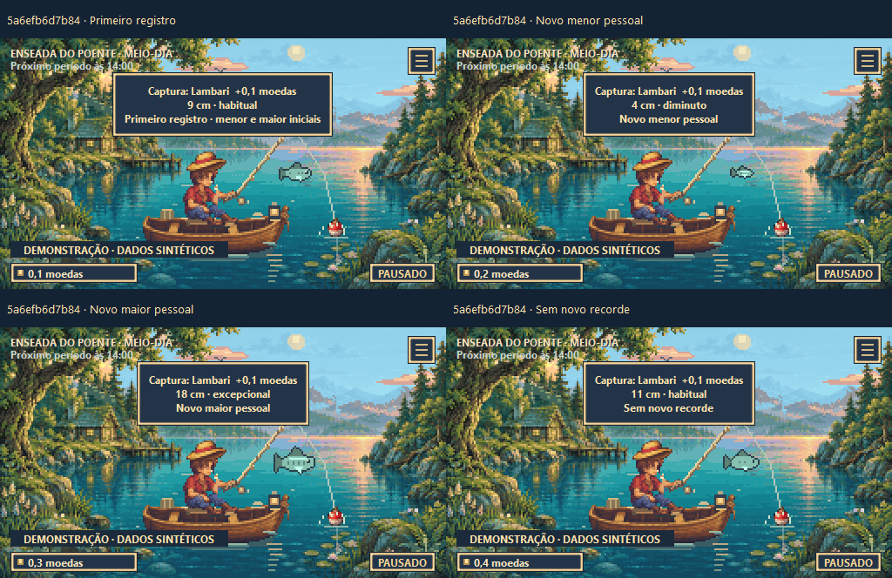
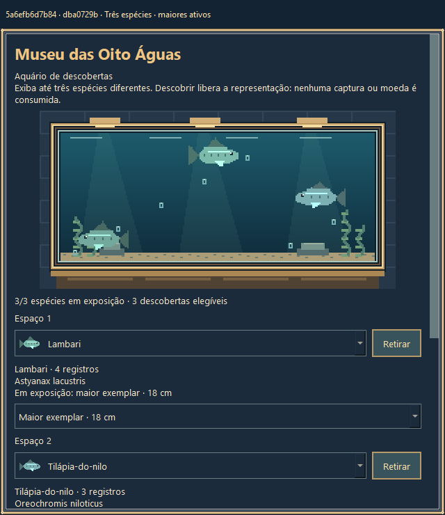
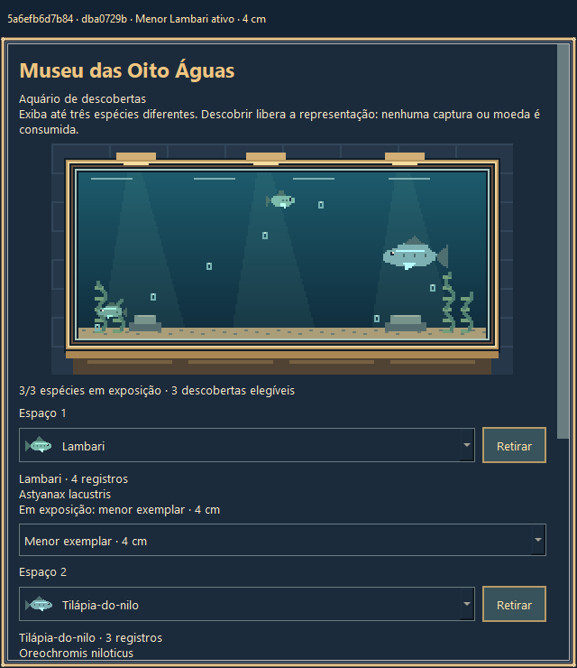

# Entrega demonstrável — resultados observados em 19/10/2026

## Identificação e escopo

- PR #5, branch remota `codex/piloto-tamanhos`, mantida em rascunho.
- Head inicial: `9d57a465ad418f885af46d11590def0753007e78`.
- Implementação: `2bbc7a87d7358a0a7fab37769e1ecabe7c5f8ade`; proteção adicional do caminho da demonstração: **`5a6efb6d7b849702f6ced5c62ddde071fceb620a`**. Este último é o código testado e compilado. O commit de evidências posterior não muda código.
- Snapshot de fontes/assets da build: `dba0729bc80f5c8ab04efd03f4d1598732a568387cb230a69d4f2dc19a0a848d`.
- Área isolada, com branch local `codex/demo-tamanhos-20261019`; checkout original preservado. Não foi encontrada instrução AGENTS.md aplicável.
- Nenhuma mudança de catálogo, preços, recompensas, probabilidades, parâmetros de tamanho, progressão ou RNG. Sem merge, Android, release, deploy ou binários novos no Git.

## Implementado

**Save:** o teste de sufixo não numérico falhou antes da correção com `SaveError not raised`. A carga agora exige prefixo exato e contador decimal ASCII positivo, já criado no perfil; erro resulta em SaveError compreensível antes de migração/escrita. IDs válidos, inclusive perfil com `:` e sufixo com zeros à esquerda, permanecem aceitos. Casos inválidos preservam bytes do save, backup e ausência de novos backups de migração. Não se apagou nem recriou arquivo rejeitado.

**Demonstração:** entrada explícita `--demo`, perfil próprio identificado visualmente, relógio civil sintético e dez capturas preparadas. São fixtures de pendentes entregues pelo motor real, com SaveStore, recordes e museu reais. Autosave, fechamento, reabertura e interrupção entre pendente/entrega foram testados sem recompensa duplicada. O caminho resolvido do arquivo também é verificado antes da leitura; o teste dessa fronteira modela o redirecionamento sem criar links no sistema ou mudar privilégios.

**Apresentação:** primeiro registro, novo menor/maior e ausência de recorde têm mensagens distintas. Capturas recebem contorno de contraste; corpo, arte compartilhada e escala uniforme permanecem iguais. Museu identifica espaços, mostra o comprimento nas escolhas e o exemplar ativo. Erros de gravação preservam a seleção anterior e aparecem por rolagem. O tanque existente foi mantido após inspeção de três espécies e verificação de limites/separação.

## Testes executados nesta revisão

Ambiente reutilizado: **Windows 11, Python 3.14.8, PySide6 6.11.2 e PyInstaller 6.22.3**. Sem instalações. Todos os perfis foram sintéticos, dentro de `qa` ou da pasta da build; APPDATA/LOCALAPPDATA/TEMP/TMP foram desviados antes de importar/iniciar o jogo. Nenhum save pessoal foi lido.

| Verificação | Resultado real |
|---|---|
| Núcleo do piloto existente | 12 testes aprovados |
| Regressão do ID pendente | 5 testes aprovados, com variações e preservação de bytes |
| Demonstração/Qt/isolamento | 10 testes aprovados, sem falhas/erros |
| Tanque | 72 verificações de limites e separação, em 24 quadros de três peixes; arte compartilhada preservada |
| Interface | Qt Windows oculto, eventos QTest, viewports 320×568, 360×800, 512×288 e 640×700 |
| Comparador contra base fixa | 82/82 cenários equivalentes; 27.276 eventos por revisão; saída 0 |
| RNG de espécies/economia | 54.649 chamadas por revisão; sequência e estados iguais no escopo comparado |
| Controles do comparador | Positivo equivalente; três mutações negativas detectadas; sem alterar o comparador revisado |
| Smoke do EXE novo | Dois processos Windows, `capture` e `reopen`, ambos saída 0 |

Base diferencial efetivamente executada: **`2a0353ff7c1cae2dca69d08c222b0660770d4385`**, candidato **`5a6efb6d7b849702f6ced5c62ddde071fceb620a`**. Execução final: **33,66 s**; controles incluídos. Também reproduziu as projeções históricas de 48 fluxos/16.010 eventos. Os resultados de `9d57a465` foram preservados como históricos, não usados como prova automática do código novo. Não foram repetidas a campanha de 100 mil amostras nem as medições amplas de esforço.

Comandos finais executados, a partir da raiz e com o Python existente:

```powershell
python -X utf8 -B -m unittest tools.verificar_tamanhos.SizeTests tools.test_save_pendente_piloto.PendingIdTests -v
python -X utf8 -B tools/test_demo_tamanhos.py --out qa/demo-validacao-final
python -X utf8 -B tools/comparar_fluxo_base.py --base 2a0353ff7c1cae2dca69d08c222b0660770d4385 --candidate 5a6efb6d7b849702f6ced5c62ddde071fceb620a --out qa/regressao-demo-final
python -X utf8 -B tools/build_demo.py --out dist/demo-5a6efb6d
```

Smoke: `PescaIdle-Tamanhos-Demo-5a6efb6d.exe --demo-smoke capture`, seguido de `--demo-smoke reopen`, com `PESCA_IDLE_DEMO_DIR=<pasta-do-EXE>/qa/smoke-01/perfil` e `PESCA_IDLE_DEMO_QA_DIR=<pasta-do-EXE>/qa/smoke-01/evidencias`. O processo também recebeu save-guard, APPDATA/LOCALAPPDATA e TEMP/TMP sintéticos antes de iniciar; cwd estrangeiro, janela oculta e timeout de 45 s. Os dois processos terminaram normalmente. [Instruções completas](README.md) mostram a preparação reproduzível. Use saídas novas ao repetir.

## Build local para abrir com dois cliques

**`dist/demo-5a6efb6d/PescaIdle-Tamanhos-Demo-5a6efb6d.exe`**, relativo à área isolada desta entrega. O caminho absoluto é fornecido na resposta ao proprietário, sem publicar o caminho privado no Git. Há também `BUILD.json` e `COMO-JOGAR.txt` nessa pasta.

- **50.465.500 bytes**, SHA-256 **`d40a09abd7f860e25f60375ff65a6801d40652b2466948416a9782c171aaa3d4`**.
- Contém o commit/snapshot acima; identificação também aparece no painel.
- Ao abrir normalmente, começa uma demonstração nova em `perfil-demo-tamanhos/save.json` ao lado do EXE. Os smokes usaram outra pasta em `qa`, portanto não consumiram esse roteiro inicial.
- Reabertura do smoke confirmou as dez medidas e escolhas **menor/maior/menor**, com inventário, saldo e conquistas iguais, sem nova captura.
- Os EXEs históricos `PescaIdle.exe` e `PescaIdle-Tamanhos-Piloto.exe` permanecem com seus hashes anteriores, registrados no JSON. A build preliminar também foi preservada localmente; use o nome **5a6efb6d** desta seção.

## Evidências pequenas e inspeção visual

[Resultados estruturados](evidencias.json) · [log dos 27 testes](testes.log). Registros completos do comparador, perfis e caches ficam em QA e são regeneráveis pelos comandos; não foram incluídos como novos dumps redundantes.

As oito imagens somam aproximadamente **376 KB**. São capturas de widgets Qt reais no Windows, com revisão/cenário nos cabeçalhos ou no nome do arquivo e legenda correspondente. Foram inspecionadas visualmente; não são desenhos de interface nem inspeção de código apresentada como teste visual. QTest injeta a entrada, sem manipulação física de mouse/toque.





[Painel e roteiro](imagens/roteiro.png) · [Vazio em 320×568](imagens/museu-vazio-320.png) · [Escolhas em 320×568](imagens/museu-escolhas-320.png) · [Erro sintético com escolha preservada](imagens/erro-selecao-320.png) · [EXE da revisão 5a6efb6d após reabertura](imagens/5a6efb6d-exe-museu-reaberto.png).

## Arquivos e limites

- `pesca_save.py`: validação do ID e diagnóstico; `tools/test_save_pendente_piloto.py`: regressão sintética.
- `pesca_idle.py`, `pesca_museu_ui.py`, `pesca_tamanho_visual.py`, `pesca_visual.py`: mensagens, escolhas e contraste, sem mudanças econômicas.
- `piloto_entry.py`, `demo_entry.py`, `tools/demo_tamanhos*.py`, fixture e `.gitignore`: entrada/controle isolados; `tools/test_demo_tamanhos.py`: testes e capturas.
- `PescaIdle.spec`, `tools/build_demo.py`, `tools/demo_smoke.py`: build separada identificada e smoke em processos.
- README e esta pasta: instruções, resultados novos e imagens. Evidências históricas do comparador não foram sobrescritas.

As medições não provam ausência de toda regressão: catálogo/pools são comparados, mas as pescarias temporais são principalmente na Enseada. Não houve Android nativo, teste físico de toque, nova CI, sessão prolongada, disco realmente defeituoso ou avaliação de retenção. A distribuição e os parâmetros provisórios existentes foram mantidos.

**Pronto para avaliação humana do piloto**, não uma declaração de prontidão para distribuição. Ainda dependem do proprietário: clareza dos tamanhos/recordes, satisfação ao superar extremos e compreensão/conforto ao escolher o exemplar no aquário. Nenhuma mudança adicional de balanceamento foi inferida desses testes.
